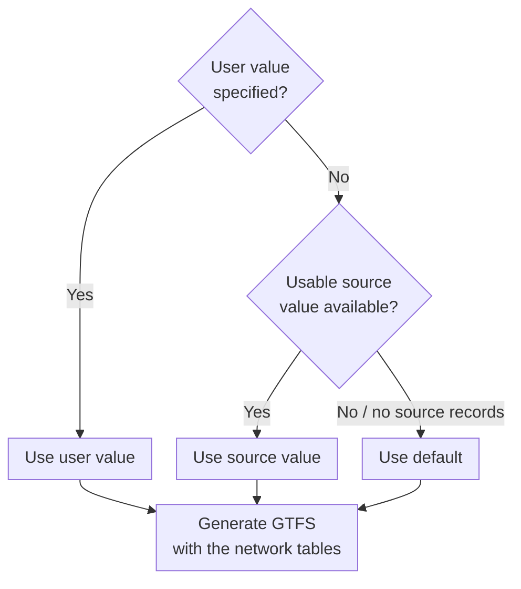
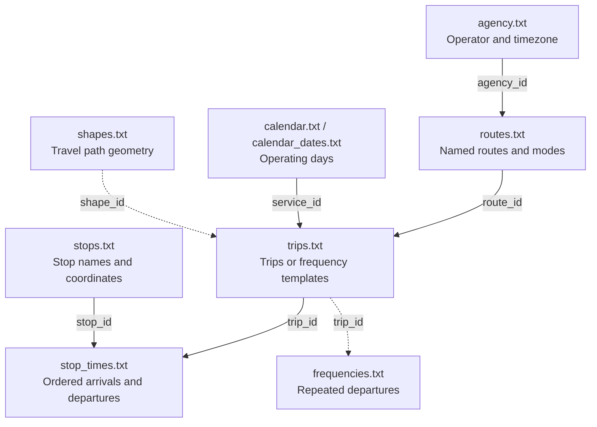

# GTFS generation guide

This guide belongs to the [Transportation module](transportation.md) and explains
the behaviour of `create_gtfs` and `load_osm_transport`. The module page lists
the function signatures.

City2Graph needs a network of routes and ordered stops. It then completes each
operating condition from your settings, interpreted source values, or a default.
The four sections below follow that process.

[Create GTFS from OpenStreetMap tutorial](../examples/creating_gtfs.md) · [Function signatures](transportation.md)

## 1. How a feed is generated { #generation-flow }

Network data defines where services run. Operating conditions define when and
how often they run, and how long they take. Both enter generation through a
common table-based input. A source loader prepares that input; you can also
construct it directly with `create_gtfs`.

<div class="gtfs-flowchart" markdown="1">



</div>

Follow this order separately for each field. A supplied value takes priority;
only an omitted field proceeds to the source lookup. If no usable source value
exists, generation uses the default. Invalid explicit inputs raise an error
rather than continuing down the fallback path.

For custom tables without source records, the source check returns no value.
Any explicit leg times, speeds or service settings still take priority.
Defaults complete operating conditions; they cannot supply missing stopping order.

<details id="gtfs-structure" markdown="1">
<summary>What is in the generated GTFS feed?</summary>

A GTFS Schedule feed is a ZIP of CSV tables linked by identifiers. This generator
uses the following subset of the [GTFS specification](https://gtfs.org/documentation/schedule/reference/#dataset-files).



Dashed links are included when frequency or shape data is supplied or derived.

| GTFS table | What one row describes |
|---|---|
| `agency.txt` | An operator and its timezone |
| `routes.txt` | A named route and transport mode |
| `stops.txt` | A stop or station location |
| `trips.txt` | A trip linked to a route and service dates |
| `stop_times.txt` | One stop visit within a trip |
| `calendar.txt`, `calendar_dates.txt` | A weekly rule or date-specific addition/removal |
| `frequencies.txt` | A trip template's interval and operating window |
| `shapes.txt` | One point in an ordered alignment |

<span id="route-pattern-and-trip"></span>

A City2Graph *pattern* is an ordered stopping sequence in one direction, such as
`A → B → C`. Return, short-turn and express sequences need separate patterns.
`patterns` and `stop_sequences` become GTFS `trips.txt` and `stop_times.txt`.

A departure time creates a scheduled trip. A window and interval create a
frequency template: 07:00–09:00 at 600-second intervals represents 12 departures
per active day. One `trips.txt` row can therefore represent many departures;
`stop_times.txt` supplies relative timings and `frequencies.txt` the repetition
rule. See the [GTFS frequency model](https://gtfs.org/documentation/schedule/examples/frequencies/).

</details>

## 2. Supply the network { #city2graph-inputs }

| Input available | Entry point | What you supply |
|---|---|---|
| Mapped OSM public transport relations | `load_osm_transport` | A place, area or relation IDs; optional selection and operating settings |
| Your own routes and ordered stops | `create_gtfs` | Four input tables; optional service, calendar and timing settings |
| An existing GTFS ZIP | `load_gtfs` | The archive path; generation is unnecessary |

`create_gtfs` consumes the common input and returns a DuckDB connection.
`load_osm_transport` is a source adapter: it retrieves OSM data, prepares those
tables, interprets [OSM tags](#operating-tags), then calls the same generator.
Custom inputs require no OSM retrieval or tags.

<details id="source-adapters" markdown="1">
<summary>Common input and source-specific adapters</summary>

The common input is `TransportData`: `routes`, `stops`, `patterns` and
`stop_sequences`, with optional metadata for interpreted source values.
Source retrieval, raw-tag parsing and source-specific grouping belong in the
adapter. Precedence, default completion and GTFS construction belong in the
shared generator.

A future loader should translate its data into this contract and preserve the
origin of each interpreted value. It should reuse the shared resolution rules.
The current source loader is OSM; other sources can already be represented by
explicit custom tables, but no additional loader is implied here.

</details>

### From OpenStreetMap { #source-interpretation }

This call retrieves Tokyo's mapped rail routes and generates a feed without
custom operating settings. The source/default choices follow the flow above;
[section 3](#configure-a-feed) shows exactly which values can be used.

<!-- gtfs-example:osm-reference -->
```python
import city2graph as c2g

osm_con = c2g.load_osm_transport(
    place_name="Tokyo 23 wards, Japan",
    modes=["subway", "train", "light_rail"],
)
```

<!-- gtfs-example:osm-summary -->
```python
from IPython.display import display

osm_report = c2g.get_gtfs_summary(osm_con)
osm_summary = osm_report["summary"]
osm_columns = [
    "pattern_count", "stop_count", "service_days", "excluded_relation_count",
]
display(osm_summary[osm_columns])
```

<!-- gtfs-output:start -->
<table>
  <thead>
    <tr style="text-align: right;">
      <th></th>
      <th>pattern_count</th>
      <th>stop_count</th>
      <th>service_days</th>
      <th>excluded_relation_count</th>
    </tr>
  </thead>
  <tbody>
    <tr>
      <th>0</th>
      <td>310</td>
      <td>1765</td>
      <td>7</td>
      <td>23</td>
    </tr>
  </tbody>
</table>
<!-- gtfs-output:end -->

Counts reflect the bundled Tokyo snapshot and may change with OSM updates.

To change which network is retrieved, use the selection parameters below.
Station grouping explains how boarding locations become graph nodes; missing-data
handling controls which incomplete relations can enter the feed.

<details id="select-the-source-data" markdown="1">
<summary>Select an area, route or mode</summary>

| Parameter | Selection or behaviour |
|---|---|
| `place_name` | Geocode a place boundary; mutually exclusive with `area` |
| `area` | A WGS84 bounding box or polygon, GeoSeries or GeoDataFrame |
| `relation_ids` | Explicit route relation IDs; can be used without an area |
| `route_name`, `route_ref` | Exact name or reference filters; ambiguous names require relation IDs |
| `modes` | One or more supported modes; defaults to all supported modes |
| `pattern_ids` | Restrict generation to named patterns, including supplemental patterns |
| `stop_level` | `"station"` (default) groups boarding locations by named stop area; `"platform"` retains source boarding IDs |
| `on_invalid` | `"skip"` (default) records and excludes unusable relations; `"raise"` requires every selected relation to be usable |
| `data`, `overwrite_source` | Supplement missing fields; allow replacement only with `overwrite_source=True` |
| `use_source_tags` | Adopt supported operating tags by default; `False` uses explicit settings and defaults |
| `endpoint`, `timeout` | Overpass endpoint and request/query timeout in seconds |

Selection by `modes`, `relation_ids` and `pattern_ids` uses their intersection.
Mode and pattern filters also apply to supplemental data. Complete relations
can extend beyond the boundary; clip the graph for a strict extent.
Supported modes and extended route types are listed in
[the loader API](transportation.md#city2graph.transportation.load_osm_transport).

<span id="osm-retrieval"></span>

Retrieval defaults:

<!-- gtfs-defaults:osm-retrieval -->

</details>

<details id="station-identities-and-stopping-order" markdown="1">
<summary>Choose station or platform nodes</summary>

The loader preserves ordered PTv2 boarding occurrences, including platform-only
stops represented by points, ways or multipolygons. Adjacent stop/platform members
match through shared names or references, local platform numbers, or geometry
within 50 m. Platform names can describe tracks rather than repeat the station
name. An unmatched platform becomes a separate stop in the ordered sequence.

By default, `stop_level="station"` groups boarding elements that belong to one
named OSM `stop_area`. The station coordinate is the mean of the available member
boarding coordinates. Consecutive occurrences at that station are collapsed;
non-consecutive returns, including loops, remain. Missing or ambiguous membership
retains individual IDs. No name-based or distance-based station clustering is
applied. `stop_level="platform"` preserves individual source boarding IDs.
Station aggregation adds no transfer time or accessibility information. Retrieved
stop-area membership and the resolution policy remain in metadata.

</details>

<details id="supplementation-and-invalid-relations" markdown="1">
<summary>Handle missing data and invalid relations</summary>

Supplementation through `data` is applied before validity checks. Replacing
source values or stopping order requires `overwrite_source=True`.
`on_invalid="skip"` warns and records excluded IDs and reasons; `"raise"` requires
every selected relation to be usable. Empty results, malformed explicit inputs
and failed downloads always raise errors.

Tag definitions: [interval and conditional interval](https://wiki.openstreetmap.org/wiki/Key:interval),
[duration](https://wiki.openstreetmap.org/wiki/Key:duration),
[opening hours](https://wiki.openstreetmap.org/wiki/Key:opening_hours),
[station groups](https://wiki.openstreetmap.org/wiki/Tag:public_transport%3Dstop_area).

</details>

### From your own tables { #from-your-own-tables }

<span id="input-tables"></span>

`create_gtfs` requires four DataFrames with matching identifiers. Operating
times and intervals can be completed automatically.

| Table | Required information | Optional information used by generation |
|---|---|---|
| `data["routes"]` | `route_id`, `route_type`, and `route_short_name` or `route_long_name` | Other GTFS route attributes |
| `data["stops"]` | `stop_id`, stop names and coordinates for boarding locations | Other GTFS stop attributes |
| `data["patterns"]` | `pattern_id`, `route_id`, `direction_id` (`0` or `1`) | Directed LineString geometry; `service_group_id` for interval allocation |
| `data["stop_sequences"]` | `pattern_id`, `stop_id`, `stop_sequence` | Incoming leg distance/time, speed, dwell or complete timing offsets |

Use `stop_lat` / `stop_lon` for pandas stop tables, or point geometry with a CRS
for a GeoDataFrame. Pattern geometry also requires a CRS and must follow the
stopping direction. A stop can occur more than once in a pattern; each visit has
a different `stop_sequence`. Inputs are copied, so generation preserves the
original DataFrames. `data["metadata"]` may additionally carry source records.

A three-stop bus route (`route_type=3`). Later examples reuse these variables.

<!-- gtfs-example:offline -->
```python
import geopandas as gpd
import pandas as pd
from IPython.display import display
from shapely.geometry import LineString, Point

import city2graph as c2g

routes = pd.DataFrame([{
    "route_id": "R1", "route_short_name": "R1", "route_type": 3,
}])
display(routes)
```

<!-- gtfs-output:start -->
<table>
  <thead>
    <tr style="text-align: right;">
      <th></th>
      <th>route_id</th>
      <th>route_short_name</th>
      <th>route_type</th>
    </tr>
  </thead>
  <tbody>
    <tr>
      <th>0</th>
      <td>R1</td>
      <td>R1</td>
      <td>3</td>
    </tr>
  </tbody>
</table>
<!-- gtfs-output:end -->

Stops are reusable locations: different patterns can refer to the same `stop_id`.
Their coordinates also provide distances when no route geometry is available.

<!-- gtfs-example:offline -->
```python
stops = gpd.GeoDataFrame(
    {"stop_id": ["A", "B", "C"], "stop_name": ["West", "Central", "East"]},
    geometry=[Point(-2.99, 53.40), Point(-2.98, 53.40), Point(-2.97, 53.40)],
    crs=4326,
)
display(stops)
```

<!-- gtfs-output:start -->
<table>
  <thead>
    <tr style="text-align: right;">
      <th></th>
      <th>stop_id</th>
      <th>stop_name</th>
      <th>geometry</th>
    </tr>
  </thead>
  <tbody>
    <tr>
      <th>0</th>
      <td>A</td>
      <td>West</td>
      <td>POINT (-2.99 53.4)</td>
    </tr>
    <tr>
      <th>1</th>
      <td>B</td>
      <td>Central</td>
      <td>POINT (-2.98 53.4)</td>
    </tr>
    <tr>
      <th>2</th>
      <td>C</td>
      <td>East</td>
      <td>POINT (-2.97 53.4)</td>
    </tr>
  </tbody>
</table>
<!-- gtfs-output:end -->

A pattern's geometry describes the travel path. Its stopping order is supplied
separately, so services can follow the same path while calling at different stops.

<!-- gtfs-example:offline -->
```python
alignment = LineString([(-2.99, 53.40), (-2.98, 53.40), (-2.97, 53.40)])
patterns = gpd.GeoDataFrame(
    {"pattern_id": ["local"], "route_id": ["R1"], "direction_id": [0]},
    geometry=[alignment],
    crs=4326,
)
display(patterns)
```

<!-- gtfs-output:start -->
<table>
  <thead>
    <tr style="text-align: right;">
      <th></th>
      <th>pattern_id</th>
      <th>route_id</th>
      <th>direction_id</th>
      <th>geometry</th>
    </tr>
  </thead>
  <tbody>
    <tr>
      <th>0</th>
      <td>local</td>
      <td>R1</td>
      <td>0</td>
      <td>LINESTRING (-2.99 53.4, -2.98 53.4, -2.97 53.4)</td>
    </tr>
  </tbody>
</table>
<!-- gtfs-output:end -->

`stop_sequence` orders visits within each pattern. Here it connects `local` to
`A → B → C`; the order of rows in the `stops` table has no scheduling meaning.

<!-- gtfs-example:offline -->
```python
stop_sequences = pd.DataFrame({
    "pattern_id": ["local"] * 3,
    "stop_sequence": [0, 1, 2],
    "stop_id": ["A", "B", "C"],
})
display(stop_sequences)
```

<!-- gtfs-output:start -->
<table>
  <thead>
    <tr style="text-align: right;">
      <th></th>
      <th>pattern_id</th>
      <th>stop_sequence</th>
      <th>stop_id</th>
    </tr>
  </thead>
  <tbody>
    <tr>
      <th>0</th>
      <td>local</td>
      <td>0</td>
      <td>A</td>
    </tr>
    <tr>
      <th>1</th>
      <td>local</td>
      <td>1</td>
      <td>B</td>
    </tr>
    <tr>
      <th>2</th>
      <td>local</td>
      <td>2</td>
      <td>C</td>
    </tr>
  </tbody>
</table>
<!-- gtfs-output:end -->

With only a service date supplied, generation estimates timings and fills the
operating window and interval. The summary shows the resulting service level.

<!-- gtfs-example:offline -->
```python
data = {
    "routes": routes,
    "stops": stops,
    "patterns": patterns,
    "stop_sequences": stop_sequences,
}
con = c2g.create_gtfs(data, service_date="20261104")
```

<!-- gtfs-example:offline -->
```python
report = c2g.get_gtfs_summary(con)
summary = report["summary"]
summary_columns = ["pattern_count", "stop_count", "service_days", "mean_daily_departures"]
display(summary[summary_columns])
```

<!-- gtfs-output:start -->
<table>
  <thead>
    <tr style="text-align: right;">
      <th></th>
      <th>pattern_count</th>
      <th>stop_count</th>
      <th>service_days</th>
      <th>mean_daily_departures</th>
    </tr>
  </thead>
  <tbody>
    <tr>
      <th>0</th>
      <td>1</td>
      <td>3</td>
      <td>1</td>
      <td>64.0</td>
    </tr>
  </tbody>
</table>
<!-- gtfs-output:end -->

## 3. Determine the operating conditions { #configure-a-feed }

Keep the network from section 2 and change only the conditions needed for your
scenario. Each row below follows the same order: your input, then a usable
source value, then the default. Source values are optional, including when
you build the input tables yourself.

<span id="field-precedence"></span>

<!-- gtfs-defaults:resolution -->

A service-row value overrides its global keyword. Explicit stop timings take
priority over speed-based estimates. Each override affects only its field:
setting a speed preserves supplied leg times, while setting `headway_secs`
replaces source base and conditional intervals.

### Your settings { #shared-settings }

Omitted or `None` fields use source values or defaults.

| Scope | Where to set it | Example |
|---|---|---|
| All selected patterns | Function keyword arguments | `headway_secs=600` |
| One pattern or service period | Rows in `services` | A shorter interval in the morning |
| One leg or stop visit | Columns in `data["stop_sequences"]` | A measured `travel_time_secs` or stop-specific dwell |

Reuse the same network and change only the operating assumptions. This limits
first-stop departures to 07:00–09:00 at ten-minute intervals.

<!-- gtfs-example:offline -->
```python
configured = c2g.create_gtfs(
    data,
    service_date="20261104",
    start_time="07:00:00",
    end_time="09:00:00",
    headway_secs=600,
)
```

<!-- gtfs-example:offline -->
```python
configured_report = c2g.get_gtfs_summary(configured)
configured_summary = configured_report["summary"]
display(configured_summary[summary_columns])
```

<!-- gtfs-output:start -->
<table>
  <thead>
    <tr style="text-align: right;">
      <th></th>
      <th>pattern_count</th>
      <th>stop_count</th>
      <th>service_days</th>
      <th>mean_daily_departures</th>
    </tr>
  </thead>
  <tbody>
    <tr>
      <th>0</th>
      <td>1</td>
      <td>3</td>
      <td>1</td>
      <td>12.0</td>
    </tr>
  </tbody>
</table>
<!-- gtfs-output:end -->

The same keywords apply to `load_osm_transport`.

Intervals must be positive whole seconds. Speeds must be positive; dwell may
be zero. Dates use `YYYYMMDD`, clock values use `HH:MM:SS`, and distances use
metres. Times after midnight can use hours above 24, such as `25:30:00`.

Choose the detail that matches the condition you need to change:

| Change | Input | Detail below |
|---|---|---|
| Fixed departures or repeating service | `services` | [Define departures for local and express patterns](#change-individual-patterns) |
| Different intervals across related patterns | `services`, `group_headway_secs` | [Allocate intervals within a route-direction group](#allocate-pattern-intervals) |
| Keep only part of the network | `pattern_ids` | [Select a subset of patterns](#select-patterns) |
| Weekdays and individual dates | `calendar`, `calendar_dates` | [Set operating days and exceptions](#windows-and-dates) |
| Leg times, speeds or stop dwell | `stop_sequences` | [Set travel and dwell times](#travel-times-and-distances) |
| Operator information or extra GTFS tables | `agency`, `optional_tables` | [Set metadata and additional tables](#agency-metadata-and-additional-tables) |

The examples reuse the three-stop network from section 2. The first adds an
express pattern; the next two reuse that expanded network. Each generation call
creates a separate scenario, so earlier operating settings do not carry over.

<details id="change-individual-patterns" markdown="1">
<summary>Define departures for local and express patterns</summary>

Each `services` row defines a fixed departure or repeating period.

| Column | Meaning |
|---|---|
| `pattern_id` | Target pattern. Omit the column to apply the supplied rows to every selected pattern |
| `departure_time` | One fixed departure at the first stop |
| `start_time`, `end_time`, `headway_secs` | A repeating departure window and interval; omitted fields can be completed |
| `exact_times` | `0` for frequency-based service (default); `1` for departures anchored to the period start |
| `service_id` | Link to the supplied calendar; generated when omitted |
| `trip_id` | Optional explicit trip/template ID; generated when omitted |
| `trip_headsign`, `trip_short_name`, `wheelchair_accessible`, `bikes_allowed` | Optional GTFS trip attributes preserved in the output |

Unlisted patterns remain in the feed. Use `pattern_ids` to select a subset.
A fixed-departure pattern receives only its listed departures; put each departure
in a separate row. Do not combine `departure_time` and frequency-window fields
on the same row. An explicit `trip_id` requires `pattern_id`; repeated trip IDs
are allowed only for separate frequency periods of the same pattern and service.
Unknown service columns raise an error.

Add an express variant that skips Central (`B`). It shares the local route and
direction, so both patterns belong to the same default frequency group.

<!-- gtfs-example:offline -->
```python
variant_patterns = pd.concat([
    patterns,
    patterns.assign(pattern_id="variant"),
], ignore_index=True)
display(variant_patterns)
```

<!-- gtfs-output:start -->
<table>
  <thead>
    <tr style="text-align: right;">
      <th></th>
      <th>pattern_id</th>
      <th>route_id</th>
      <th>direction_id</th>
      <th>geometry</th>
    </tr>
  </thead>
  <tbody>
    <tr>
      <th>0</th>
      <td>local</td>
      <td>R1</td>
      <td>0</td>
      <td>LINESTRING (-2.99 53.4, -2.98 53.4, -2.97 53.4)</td>
    </tr>
    <tr>
      <th>1</th>
      <td>variant</td>
      <td>R1</td>
      <td>0</td>
      <td>LINESTRING (-2.99 53.4, -2.98 53.4, -2.97 53.4)</td>
    </tr>
  </tbody>
</table>
<!-- gtfs-output:end -->

The variant keeps the same alignment but omits the visit to `B`. The remaining
sequence values can retain gaps; their order determines the next stop.

<!-- gtfs-example:offline -->
```python
variant_stop_sequences = pd.concat([
    stop_sequences,
    stop_sequences.query("stop_id != 'B'").assign(pattern_id="variant"),
], ignore_index=True)
display(variant_stop_sequences)
```

<!-- gtfs-output:start -->
<table>
  <thead>
    <tr style="text-align: right;">
      <th></th>
      <th>pattern_id</th>
      <th>stop_sequence</th>
      <th>stop_id</th>
    </tr>
  </thead>
  <tbody>
    <tr>
      <th>0</th>
      <td>local</td>
      <td>0</td>
      <td>A</td>
    </tr>
    <tr>
      <th>1</th>
      <td>local</td>
      <td>1</td>
      <td>B</td>
    </tr>
    <tr>
      <th>2</th>
      <td>local</td>
      <td>2</td>
      <td>C</td>
    </tr>
    <tr>
      <th>3</th>
      <td>variant</td>
      <td>0</td>
      <td>A</td>
    </tr>
    <tr>
      <th>4</th>
      <td>variant</td>
      <td>2</td>
      <td>C</td>
    </tr>
  </tbody>
</table>
<!-- gtfs-output:end -->

These rows combine a fixed local departure with a repeating express service.
The missing cells are intentional: a fixed departure needs no interval, and a
frequency period needs no single `departure_time`.

<!-- gtfs-example:offline -->
```python
services = pd.DataFrame([
    {"pattern_id": "local", "departure_time": "08:05:00"},
    {"pattern_id": "variant", "start_time": "08:00:00", "end_time": "10:00:00",
     "headway_secs": 1200, "exact_times": 0},
])
display(services)
```

<!-- gtfs-output:start -->
<table>
  <thead>
    <tr style="text-align: right;">
      <th></th>
      <th>pattern_id</th>
      <th>departure_time</th>
      <th>start_time</th>
      <th>end_time</th>
      <th>headway_secs</th>
      <th>exact_times</th>
    </tr>
  </thead>
  <tbody>
    <tr>
      <th>0</th>
      <td>local</td>
      <td>08:05:00</td>
      <td>NaN</td>
      <td>NaN</td>
      <td>NaN</td>
      <td>NaN</td>
    </tr>
    <tr>
      <th>1</th>
      <td>variant</td>
      <td>NaN</td>
      <td>08:00:00</td>
      <td>10:00:00</td>
      <td>1200.0</td>
      <td>0.0</td>
    </tr>
  </tbody>
</table>
<!-- gtfs-output:end -->

The agency timezone determines how departure times are interpreted. This
Liverpool example supplies `Europe/London` explicitly.

<!-- gtfs-example:offline -->
```python
agency = pd.DataFrame([{
    "agency_name": "Study operator", "agency_url": "https://example.org",
    "agency_timezone": "Europe/London",
}])
display(agency)
```

<!-- gtfs-output:start -->
<table>
  <thead>
    <tr style="text-align: right;">
      <th></th>
      <th>agency_name</th>
      <th>agency_url</th>
      <th>agency_timezone</th>
    </tr>
  </thead>
  <tbody>
    <tr>
      <th>0</th>
      <td>Study operator</td>
      <td>https://example.org</td>
      <td>Europe/London</td>
    </tr>
  </tbody>
</table>
<!-- gtfs-output:end -->

Keep this two-pattern scenario in `variant_data`; the original `data` still
contains only the local pattern and is reused in the calendar example.

<!-- gtfs-example:offline -->
```python
variant_data = {
    "routes": routes,
    "stops": stops,
    "patterns": variant_patterns,
    "stop_sequences": variant_stop_sequences,
}
variant_con = c2g.create_gtfs(
    variant_data, services=services, agency=agency, service_date="20261102",
)
```

<!-- gtfs-example:offline -->
```python
variant_report = c2g.get_gtfs_summary(variant_con)
service_columns = ["pattern_id", "departure_time", "start_time", "end_time",
                   "headway_secs", "departures"]
display(variant_report["services"][service_columns])
```

<!-- gtfs-output:start -->
<table>
  <thead>
    <tr style="text-align: right;">
      <th></th>
      <th>pattern_id</th>
      <th>departure_time</th>
      <th>start_time</th>
      <th>end_time</th>
      <th>headway_secs</th>
      <th>departures</th>
    </tr>
  </thead>
  <tbody>
    <tr>
      <th>0</th>
      <td>local</td>
      <td>08:05:00</td>
      <td>&lt;NA&gt;</td>
      <td>&lt;NA&gt;</td>
      <td>&lt;NA&gt;</td>
      <td>1.0</td>
    </tr>
    <tr>
      <th>1</th>
      <td>variant</td>
      <td>&lt;NA&gt;</td>
      <td>08:00:00</td>
      <td>10:00:00</td>
      <td>1200</td>
      <td>6.0</td>
    </tr>
  </tbody>
</table>
<!-- gtfs-output:end -->

</details>

<details id="allocate-pattern-intervals" markdown="1">
<summary>Allocate intervals within a route-direction group</summary>

Reuse `variant_data` from the local/express example above. Override the local
interval; the unlisted variant receives its share of the group interval:

<!-- gtfs-example:offline -->
```python
interval_overrides = pd.DataFrame([{
    "pattern_id": "local", "headway_secs": 600,
}])
display(interval_overrides)
```

<!-- gtfs-output:start -->
<table>
  <thead>
    <tr style="text-align: right;">
      <th></th>
      <th>pattern_id</th>
      <th>headway_secs</th>
    </tr>
  </thead>
  <tbody>
    <tr>
      <th>0</th>
      <td>local</td>
      <td>600</td>
    </tr>
  </tbody>
</table>
<!-- gtfs-output:end -->

Each call generates a new scenario from its inputs. This call uses
`interval_overrides`, so the earlier fixed departure in `services` does not carry
over. Both patterns now receive repeating service.

<!-- gtfs-example:offline -->
```python
adjusted = c2g.create_gtfs(
    variant_data, services=interval_overrides,
    group_headway_secs=900, service_date="20261102",
)
```

<!-- gtfs-example:offline -->
```python
adjusted_report = c2g.get_gtfs_summary(adjusted)
interval_columns = ["pattern_id", "group_headway_secs", "headway_secs",
                    "frequency_scope", "departures"]
display(adjusted_report["services"][interval_columns])
```

<!-- gtfs-output:start -->
<table>
  <thead>
    <tr style="text-align: right;">
      <th></th>
      <th>pattern_id</th>
      <th>group_headway_secs</th>
      <th>headway_secs</th>
      <th>frequency_scope</th>
      <th>departures</th>
    </tr>
  </thead>
  <tbody>
    <tr>
      <th>0</th>
      <td>local</td>
      <td>&lt;NA&gt;</td>
      <td>600</td>
      <td>per pattern</td>
      <td>96.0</td>
    </tr>
    <tr>
      <th>1</th>
      <td>variant</td>
      <td>900</td>
      <td>1800</td>
      <td>shared route-direction budget</td>
      <td>32.0</td>
    </tr>
  </tbody>
</table>
<!-- gtfs-output:end -->

<span id="departure-intervals"></span>

Per-pattern intervals apply unchanged. A group interval is multiplied by the
number of selected patterns in that group; see [precedence](#field-precedence).

Supply at most one global interval keyword. A group is defined by route and
direction, or by `patterns.service_group_id`. All selected patterns count towards
group size, including those with fixed departures, individual intervals or
closures. Unused shares are not redistributed.

For two patterns in one group, both running 06:00–22:00 on one day, with no source
intervals or individual overrides:

| Input | Interval per pattern | Combined expected departures |
|---|---:|---:|
| No interval keyword | 1,800 s | 64 |
| `group_headway_secs=900` | 1,800 s | 64 |
| `headway_secs=900` | 900 s | 128 |

</details>

<details id="select-patterns" markdown="1">
<summary>Select a subset of patterns</summary>

Reuse `variant_data` and `services` from the local/express example.
Select only the fixed local departure:

<!-- gtfs-example:offline -->
```python
selected = c2g.create_gtfs(
    variant_data, services=services, pattern_ids="local", service_date="20261102",
)
```

<!-- gtfs-example:offline -->
```python
selected_report = c2g.get_gtfs_summary(selected)
display(selected_report["services"][service_columns])
```

<!-- gtfs-output:start -->
<table>
  <thead>
    <tr style="text-align: right;">
      <th></th>
      <th>pattern_id</th>
      <th>departure_time</th>
      <th>start_time</th>
      <th>end_time</th>
      <th>headway_secs</th>
      <th>departures</th>
    </tr>
  </thead>
  <tbody>
    <tr>
      <th>0</th>
      <td>local</td>
      <td>08:05:00</td>
      <td>&lt;NA&gt;</td>
      <td>&lt;NA&gt;</td>
      <td>&lt;NA&gt;</td>
      <td>1.0</td>
    </tr>
  </tbody>
</table>
<!-- gtfs-output:end -->

</details>

<details id="windows-and-dates" markdown="1">
<summary>Set operating days and exceptions</summary>

A complete explicit window overrides source opening hours. If only one boundary
is supplied, source periods supply the other and retain their weekday restrictions.
For example, source `Mo-Fr 07:00-10:00` with `start_time="08:00:00"` gives
08:00–10:00 on weekdays, with weekends closed. Fixed departures override source
opening hours; the supplied calendar still applies.

`service_date` selects one day and cannot be combined with `calendar` or
`calendar_dates`. With neither, the default week starts on the generation date in the local system
timezone and covers seven consecutive days.
These dates determine weekday restrictions and the counting period for
`travel_summary_graph`; source retrieval timestamps are separate.

For frequency rows, the end of the departure window is exclusive. Arrivals at
later stops may fall outside it. With `exact_times=0`, expected departures are
eligible seconds divided by headway and may be fractional. Fixed departures and
`exact_times=1` use discrete counts. Closed days remain in `services` with zero
departures.

Calendar and service rows must share a `service_id`. This example runs on
weekdays, excluding Wednesday:

<!-- gtfs-example:offline -->
```python
calendar = pd.DataFrame([{
    "service_id": "weekdays",
    "monday": 1, "tuesday": 1, "wednesday": 1, "thursday": 1, "friday": 1,
    "saturday": 0, "sunday": 0, "start_date": "20261102", "end_date": "20261108",
}])
display(calendar)
```

<!-- gtfs-output:start -->
<table>
  <thead>
    <tr style="text-align: right;">
      <th></th>
      <th>service_id</th>
      <th>monday</th>
      <th>tuesday</th>
      <th>wednesday</th>
      <th>thursday</th>
      <th>friday</th>
      <th>saturday</th>
      <th>sunday</th>
      <th>start_date</th>
      <th>end_date</th>
    </tr>
  </thead>
  <tbody>
    <tr>
      <th>0</th>
      <td>weekdays</td>
      <td>1</td>
      <td>1</td>
      <td>1</td>
      <td>1</td>
      <td>1</td>
      <td>0</td>
      <td>0</td>
      <td>20261102</td>
      <td>20261108</td>
    </tr>
  </tbody>
</table>
<!-- gtfs-output:end -->

Exceptions modify individual dates without changing the weekly rule.
`exception_type=2` removes 4 November; `1` would add a date.

<!-- gtfs-example:offline -->
```python
exceptions = pd.DataFrame([{
    "service_id": "weekdays", "date": "20261104", "exception_type": 2,
}])
display(exceptions)
```

<!-- gtfs-output:start -->
<table>
  <thead>
    <tr style="text-align: right;">
      <th></th>
      <th>service_id</th>
      <th>date</th>
      <th>exception_type</th>
    </tr>
  </thead>
  <tbody>
    <tr>
      <th>0</th>
      <td>weekdays</td>
      <td>20261104</td>
      <td>2</td>
    </tr>
  </tbody>
</table>
<!-- gtfs-output:end -->

`service_id` connects the calendar to a pattern's operating conditions.
Leaving the interval and window unspecified lets generation complete them.

<!-- gtfs-example:offline -->
```python
weekday_services = pd.DataFrame([{
    "pattern_id": "local", "service_id": "weekdays",
}])
display(weekday_services)
```

<!-- gtfs-output:start -->
<table>
  <thead>
    <tr style="text-align: right;">
      <th></th>
      <th>pattern_id</th>
      <th>service_id</th>
    </tr>
  </thead>
  <tbody>
    <tr>
      <th>0</th>
      <td>local</td>
      <td>weekdays</td>
    </tr>
  </tbody>
</table>
<!-- gtfs-output:end -->

Use the original single-pattern `data` here. The weekly calendar and its
exception replace the single `service_date` used in earlier examples.

<!-- gtfs-example:offline -->
```python
weekdays = c2g.create_gtfs(
    data,
    services=weekday_services,
    calendar=calendar,
    calendar_dates=exceptions,
)
```

<!-- gtfs-example:offline -->
```python
weekday_report = c2g.get_gtfs_summary(weekdays)
display(weekday_report["services"][["date", "departures"]])
```

<!-- gtfs-output:start -->
<table>
  <thead>
    <tr style="text-align: right;">
      <th></th>
      <th>date</th>
      <th>departures</th>
    </tr>
  </thead>
  <tbody>
    <tr>
      <th>0</th>
      <td>20261102</td>
      <td>64.0</td>
    </tr>
    <tr>
      <th>1</th>
      <td>20261103</td>
      <td>64.0</td>
    </tr>
    <tr>
      <th>2</th>
      <td>20261104</td>
      <td>0.0</td>
    </tr>
    <tr>
      <th>3</th>
      <td>20261105</td>
      <td>64.0</td>
    </tr>
    <tr>
      <th>4</th>
      <td>20261106</td>
      <td>64.0</td>
    </tr>
    <tr>
      <th>5</th>
      <td>20261107</td>
      <td>0.0</td>
    </tr>
    <tr>
      <th>6</th>
      <td>20261108</td>
      <td>0.0</td>
    </tr>
  </tbody>
</table>
<!-- gtfs-output:end -->

Zero-departure dates remain in the report and count towards mean daily service.
For irregular schedules, `calendar_dates` can instead list every active date
without a weekly `calendar`.

</details>

<details id="travel-times-and-distances" markdown="1">
<summary>Set travel and dwell times</summary>

Set individual leg or stop values in `data["stop_sequences"]`:

| Column | Unit | Meaning |
|---|---|---|
| `travel_time_secs` | seconds | Previous stop's departure to this stop's arrival |
| `distance_m` | metres | Incoming leg distance |
| `speed_kph` | km/h | Speed for this incoming leg when its time is unspecified |
| `shape_dist_traveled` | metres | Cumulative distance along the pattern; successive differences give leg lengths |
| `dwell_time_secs` | seconds | Time between arrival and departure at this stop |
| `arrival_offset_secs`, `departure_offset_secs` | seconds | Paired times relative to the pattern's timing origin; already include dwell |

Route duration is apportioned after reserving known leg times, supplied leg
speeds and intermediate dwell. The positive remainder is distributed by distance
among untimed legs. For `duration=00:12` and untimed distances of 1 km and 2 km,
the estimated times are 240 s and 480 s. If the first leg already has an explicit
time of 120 s, the second receives 600 s.

An untimed leg obtains distance from:

1. `distance_m`.
2. A difference in cumulative `shape_dist_traveled`.
3. A usable directed route shape.
4. Geodesic distance between stops.

`distance_method="auto"` records the basis used. `"shape"` requires usable shape
geometry when geometry is needed; `"geodesic"` skips shape projection. A
zero-distance or unresolvable leg needs a positive supplied distance or time.

The first row's incoming time is unused. Supply `arrival_offset_secs` and
`departure_offset_secs` together on each occurrence using them.

</details>

<details id="agency-metadata-and-additional-tables" markdown="1">
<summary>Set metadata and additional tables</summary>

`agency` requires `agency_name`, `agency_url` and `agency_timezone`. Missing
metadata uses interpreted source information, then placeholders. Timezone inference
requires all stops to share one unique land timezone; otherwise it falls back
to UTC with a warning. Lookup versions and source timezone conflicts are recorded.

<span id="agency-metadata"></span>

Metadata defaults:

<!-- gtfs-defaults:agency-metadata -->

Use `optional_tables` for existing GTFS `transfers`, `pathways`, `levels`,
`feed_info` or `attributions` DataFrames, keyed by those names without `.txt`.
Walking, waiting and transfer costs require an explicit analysis model, as in the
[Tokyo multimodal isochrone example](../examples/creating_gtfs.md#walk-and-rail-isochrones-from-tokyo-station).

</details>

### Values from a data source { #source-values }

The generator uses interpreted source records supplied with the input. An
adapter decides how to extract and validate them; generation applies the same
precedence regardless of their origin.

<span id="operating-tags"></span>

For the OSM adapter, the mapping is below. Tags are read from selected route
relations, whose pattern IDs are `osm:relation:<id>`. These rules are specific
to OSM.

| Generated information | OSM tag on the route relation | How it is used |
|---|---|---|
| Departure interval | `interval`, `interval:conditional` | Base interval and weekday/time-specific changes |
| Operating window and weekdays | `opening_hours` | First-stop departure periods within the selected service dates |
| Travel time | `duration` | Total route duration allocated to untimed legs by distance |
| Agency name | `operator` | Operator metadata |
| Agency URL | `operator:website`, then `website`, then `url` | First available URL in this order |
| Agency timezone | `timezone` | Source timezone before geographical inference |

A unique immediate parent `route_master` can fill missing tags. Child tags win
for the same key; URL selection uses the order above after this inheritance.
Child interval tags replace the parent's whole interval family. Parent `duration`
is never inherited, because variants may have different lengths and stopping patterns.
Multiple candidate parents leave inheritance unresolved.

`use_source_tags=False` skips operating-tag adoption, while retaining parent
group membership and agency metadata. It does not discard the mapped network.

<details id="osm-tag-formats" markdown="1">
<summary>Supported OSM formats and rejection rules</summary>

| Tag | Supported values |
|---|---|
| `interval` | Positive integer minutes, `HH:MM` or `HH:MM:SS` |
| `opening_hours` | `24/7`, weekday lists/ranges, fixed time periods and `off` / `closed` |
| `interval:conditional` | Weekday and fixed-time clauses, with optional parentheses; timed clauses override weekday-only baselines, and the base interval applies elsewhere |
| `duration` | Positive `H:MM` or `H:MM:SS`; an integer without units is rejected |

Overnight periods belong to their starting service day and use GTFS hours above
24. Fixed clocks accept one- or two-digit hours; an end such as `24:30`
refers to the following day. Holiday, seasonal, solar-time and overlapping
clock-specific rules are unsupported. An unsupported conditional interval
rejects the whole interval family, including the base interval.

</details>

### Default assumptions { #defaults }

Defaults for model `simple-v1`, generated from the implementation registry.
Service defaults provide an uncalibrated reference timetable. The reference week
starts on the date you generate the feed, using the local system timezone. The
adopted date is stored in metadata; loading a saved feed preserves that date.

These apply only to fields still unresolved after your settings and usable
source values. A default frequency is a modelling assumption, not an observed
service count. Check its origin in the report in section 4.

<details id="default-mode-speeds" markdown="1">
<summary>Mode speeds</summary>

<span id="mode-speeds"></span>

Default speeds are uncalibrated averages that include stopping effects, so
additional dwell defaults to zero. Extended route types retain their codes
and inherit their mode group's speed.

<!-- gtfs-defaults:speeds -->

</details>

<span id="operating-rules"></span>
<span id="operating-conditions-and-metadata"></span>

Operating and date defaults are listed here. For other defaults, see
[OSM retrieval](#select-the-source-data), [agency metadata](#agency-metadata-and-additional-tables)
and [saving and loading](#save-and-restore).

<span id="operating-assumptions"></span>

<!-- gtfs-defaults:operating-assumptions -->

<span id="reference-dates"></span>

<!-- gtfs-defaults:reference-dates -->

## 4. Inspect and save the feed { #reading-and-preserving-results }

The report connects the generated result back to the choices in section 3:
`services` shows the completed operating conditions, and `assumptions` records
whether values were supplied, read from a source, estimated or defaulted.

`GTFSGenerationWarning` indicates estimates, assumptions or placeholders.
`get_gtfs_summary` returns their details alongside the service results:

| Table | Contents |
|---|---|
| `summary` | Model, date bounds, route/pattern/stop counts, departures, adopted speed range and excluded-relation count |
| `services` | Daily windows, intervals and expected departures by pattern |
| `assumptions` | Values, origins, reasons, source details and retrieval context |
| `edges` | Directed adjacent-stop sections aggregated across active dates |

`table_name="assumptions"` identifies effective choices; `operation_source` rows
retain interpreted fields and raw tags. `estimated` marks calculations and
`generated` marks created IDs. `ignored` records discarded information.

Mean daily departures divide by all dates between the bounds, including closures.
Speed bounds cover speeds used for untimed legs. Pattern counts distinguish
supplied service rows from automatically completed patterns; individual fields
within a supplied row can still be completed. Frequency columns remain present
but null for fixed departures.

Inspect the original three-stop feed, `con`, from section 2. The service report
counts all departures represented by its frequency template.

<!-- gtfs-example:offline -->
```python
report = c2g.get_gtfs_summary(con)
daily_services = report["services"][["pattern_id", "date", "departures"]]
display(daily_services)
```

<!-- gtfs-output:start -->
<table>
  <thead>
    <tr style="text-align: right;">
      <th></th>
      <th>pattern_id</th>
      <th>date</th>
      <th>departures</th>
    </tr>
  </thead>
  <tbody>
    <tr>
      <th>0</th>
      <td>local</td>
      <td>20261104</td>
      <td>64.0</td>
    </tr>
  </tbody>
</table>
<!-- gtfs-output:end -->

The `kind` column distinguishes supplied or estimated values from defaults.
Check it before treating generated travel times as measured performance.

<!-- gtfs-example:offline -->
```python
timing_assumptions = report["assumptions"].query(
    "field in ['speed_kph', 'dwell_time_secs']"
)[["field", "value", "kind"]].drop_duplicates()
display(timing_assumptions)
```

<!-- gtfs-output:start -->
<table>
  <thead>
    <tr style="text-align: right;">
      <th></th>
      <th>field</th>
      <th>value</th>
      <th>kind</th>
    </tr>
  </thead>
  <tbody>
    <tr>
      <th>16</th>
      <td>dwell_time_secs</td>
      <td>0</td>
      <td>default</td>
    </tr>
    <tr>
      <th>18</th>
      <td>speed_kph</td>
      <td>20</td>
      <td>default</td>
    </tr>
  </tbody>
</table>
<!-- gtfs-output:end -->

The exported trip IDs link the service definitions to their stop times.
Use these IDs to trace a report result back to the GTFS records.

<!-- gtfs-example:offline -->
```python
trips = con.table("trips").df()
display(trips[["trip_id", "route_id", "service_id"]])
```

<!-- gtfs-output:start -->
<table>
  <thead>
    <tr style="text-align: right;">
      <th></th>
      <th>trip_id</th>
      <th>route_id</th>
      <th>service_id</th>
    </tr>
  </thead>
  <tbody>
    <tr>
      <th>0</th>
      <td>service_0</td>
      <td>R1</td>
      <td>synthetic:local</td>
    </tr>
  </tbody>
</table>
<!-- gtfs-output:end -->

The frequency template starts at `00:00:00`. These relative timings are reused
for each departure in its operating window.

<!-- gtfs-example:offline -->
```python
stop_times = con.table("stop_times").df()
stop_time_columns = ["trip_id", "stop_sequence", "stop_id", "arrival_time", "departure_time"]
display(stop_times[stop_time_columns])
```

<!-- gtfs-output:start -->
<table>
  <thead>
    <tr style="text-align: right;">
      <th></th>
      <th>trip_id</th>
      <th>stop_sequence</th>
      <th>stop_id</th>
      <th>arrival_time</th>
      <th>departure_time</th>
    </tr>
  </thead>
  <tbody>
    <tr>
      <th>0</th>
      <td>service_0</td>
      <td>0</td>
      <td>A</td>
      <td>00:00:00</td>
      <td>00:00:00</td>
    </tr>
    <tr>
      <th>1</th>
      <td>service_0</td>
      <td>1</td>
      <td>B</td>
      <td>00:02:00</td>
      <td>00:02:00</td>
    </tr>
    <tr>
      <th>2</th>
      <td>service_0</td>
      <td>2</td>
      <td>C</td>
      <td>00:03:59</td>
      <td>00:03:59</td>
    </tr>
  </tbody>
</table>
<!-- gtfs-output:end -->

For `travel_summary_graph`, `frequency` is the total number of leg traversals
over the selected dates, including frequency-based services. `travel_time_sec`
is the service-weighted mean time from the previous stop's departure to the
next stop's arrival. Divide counts by the appropriate number of days for a
daily map; counts describe modelled service, not passenger demand.

### Save and restore { #save-and-restore }

<!-- gtfs-example:offline -->
```python
output = c2g.save_gtfs(con, "synthetic.zip")
restored = c2g.load_gtfs(output)
```

<!-- gtfs-example:offline -->
```python
restored_report = c2g.get_gtfs_summary(restored)
display(restored_report["summary"][summary_columns])
```

<!-- gtfs-output:start -->
<table>
  <thead>
    <tr style="text-align: right;">
      <th></th>
      <th>pattern_count</th>
      <th>stop_count</th>
      <th>service_days</th>
      <th>mean_daily_departures</th>
    </tr>
  </thead>
  <tbody>
    <tr>
      <th>0</th>
      <td>1</td>
      <td>3</td>
      <td>1</td>
      <td>64.0</td>
    </tr>
  </tbody>
</table>
<!-- gtfs-output:end -->

Existing files are protected; use `overwrite=True` to replace an archive.
`save_gtfs` embeds metadata inside the ZIP, and `load_gtfs` restores it.
Set `include_metadata=False` when saving or loading to use only the GTFS tables.
Malformed embedded history raises an error. A generation summary requires complete
embedded history; feeds loaded without it remain available for graph analysis.

<span id="saving-and-loading"></span>

Archive defaults:

<!-- gtfs-defaults:saving-and-loading -->

Close the connections after the remaining inspection or export work is complete.

<!-- gtfs-example:offline -->
```python
con.close()
restored.close()
```

Close other scenario connections when you have finished using them.
