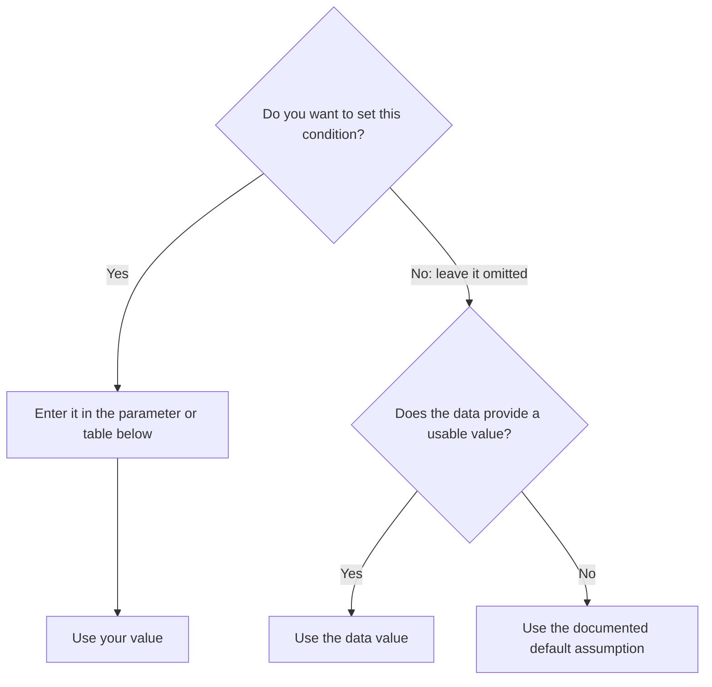

# Creating and saving public transport feeds

City2Graph uses supplied stopping patterns and interpretable source information
before filling gaps with a reproducible synthetic service. Missing operating
conditions do not require manual configuration. A generated feed is a modelling
scenario, **not an observed timetable**. The provisional default speeds have not
been calibrated or validated globally.

## 1. Create, inspect and save a small feed

This example needs no network access. Two patterns share a route, direction and
three stops. The returned DuckDB connection also works with the existing
transportation analysis functions.

<!-- gtfs-example:offline -->
```python
from pathlib import Path

import geopandas as gpd
import pandas as pd
from shapely.geometry import LineString, Point

import city2graph as c2g

alignment = LineString([(-2.99, 53.40), (-2.98, 53.40), (-2.97, 53.40)])
data: c2g.TransportData = {
    "routes": pd.DataFrame([{"route_id": "R1", "route_short_name": "R1", "route_type": 3}]),
    "stops": gpd.GeoDataFrame(
        {"stop_id": ["A", "B", "C"], "stop_name": ["West", "Central", "East"]},
        geometry=[Point(-2.99, 53.40), Point(-2.98, 53.40), Point(-2.97, 53.40)],
        crs=4326,
    ),
    "patterns": gpd.GeoDataFrame(
        {"pattern_id": ["local", "variant"], "route_id": ["R1", "R1"],
         "direction_id": [0, 0]},
        geometry=[alignment, alignment], crs=4326,
    ),
    "stop_sequences": pd.DataFrame({
        "pattern_id": ["local"] * 3 + ["variant"] * 3,
        "stop_sequence": [0, 1, 2, 0, 1, 2],
        "stop_id": ["A", "B", "C", "A", "B", "C"],
    }),
}
con = c2g.create_gtfs(data)
report = c2g.gtfs_generation_report(con)
print(report["services"][["date", "pattern_id", "headway_secs", "departures"]])
print(report["edges"][["travel_time_sec", "frequency"]])
output = c2g.save_gtfs(con, Path("minimal.zip"))
```

All input frames remain unchanged. Geometry needs a declared CRS; the generator
reprojects it to WGS84 where needed. `stop_sequence` orders occurrences, allowing
repeated visits to the same stop. Each direction and pattern is explicit.
`save_gtfs` also writes `minimal.zip.provenance.json`. Existing outputs are
protected; use `overwrite=True` when intentionally replacing a previous run.

## 2. Decide what to enter and what to leave automatic

**Enter only the conditions you want to control. Leave the rest omitted.**
City2Graph resolves each missing condition separately: it uses interpretable
source information first, then a documented assumption. A feed can therefore
combine your operating hours, a source interval and an assumed speed.

First provide the **route, stops and stopping order**, or obtain them with a
loader. These are required structure: City2Graph does not invent missing routes
or stopping orders. `create_gtfs(data)` uses your tables; `load_osm_transport`
extracts them from selected relations; `load_overture_transport` still requires
you to supply routes, patterns and stop sequences.

### A. Decide which values you want to control

Use the following flow **once for each condition**, such as the departure
interval, operating window or travel time. Supplying one condition does not
require you to supply the others.

<div class="gtfs-flowchart" markdown="1">



</div>

An invalid value that **you supply** raises an error; it never silently becomes a
default. An unsupported **source expression** is recorded with its rejection
reason, then treated as unavailable. Assumed or estimated values appear in the
report and a summary warning.

| Condition | To set it yourself | When omitted, use data if available | If the data cannot supply it |
|---|---|---|---|
| **Departure interval** | `services.headway_secs` for particular patterns; otherwise `headway_secs` for every pattern **or** `group_headway_secs` for a shared group rate. See B below. | OSM `interval` and supported `interval:conditional`, per pattern. | A shared group interval of **900 s**, multiplied by the number of selected patterns to obtain each pattern's interval. |
| **Operating window** | `services.start_time` / `end_time` for particular patterns; otherwise `start_time` / `end_time` for all patterns. | Supported OSM `opening_hours`. | **06:00–22:00**. The end is exclusive for departures. |
| **Travel time** | Exact offsets or `stop_sequences.travel_time_secs`; for untimed legs, per-leg `speed_kph` or global `speed_kph`. See C below. | Usable OSM whole-route `duration`, allocated to untimed legs by distance. | Distance divided by the provisional mode speed, e.g. **20 km/h for a bus**. |
| **Dwell at a stop** | `stop_sequences.dwell_time_secs`, otherwise global `dwell_time_secs`. | Complete supplied offsets already include dwell. OSM duration does not provide individual stop dwell. | **0 s** additional dwell. |
| **Service dates** | `service_date="20261103"` for one day, or `calendar` / `calendar_dates` for a schedule. | Source weekday restrictions apply within the selected dates; they do not determine the study dates. | The fixed reference week **2026-01-03–2026-01-09**, not the current week. |
| **Agency** | `agency` with the operator name, URL and timezone. | Available source metadata; otherwise an unambiguous geographical timezone estimate. | Synthetic name, project URL and, if timezone inference fails, **UTC**. |

For row-specific conditions, use `services` and `stop_sequences`. A row-specific
value takes priority over a global keyword for the same condition. **A partial
`services` table changes conditions, not the generation target:** unlisted
patterns remain. Select the target separately with `pattern_ids`; loaders also
accept `modes`.

### B. Choose fixed departures or a departure interval

**If you know the departure times**, put each departure in a separate
`services.departure_time` row. That pattern gets those departures and no added
frequency service. Do not mix `departure_time` with `start_time`, `end_time` or
`headway_secs` in the same row. Global frequency settings can still apply to
other patterns. To generate only the patterns in your timetable, also pass
`pattern_ids=services["pattern_id"].unique().tolist()`.

**Otherwise, choose how to determine the interval.** For each pattern, the first
available item in this list wins:

1. Its **`services.headway_secs`** value.
2. Global **`headway_secs`**, used unchanged for each pattern.
3. Global **`group_headway_secs` × number of selected patterns in its group**.
4. The pattern's **source interval**, used unchanged.
5. The assumed **900 s × number of selected patterns in its group**.

Supply at most one of the two global interval parameters. A group is defined by
route and direction, or by `patterns.service_group_id`. All selected patterns
count towards the group size, including patterns with their own interval, fixed
departures or closures; unused shares are not redistributed.

For **two patterns in one group**, both operating 06:00–22:00 on one day, with
no source intervals, closures or individual overrides:

| What you pass | Interval used by each pattern | Total expected departures per day |
|---|---:|---:|
| Neither interval parameter | 1,800 s | 64 |
| `group_headway_secs=900` | 1,800 s | 64 |
| `headway_secs=900` | 900 s | 128 |

### C. Supply travel times only where you know them

For each leg, complete arrival/departure offsets or an explicit
`travel_time_secs` take priority. Remaining legs use an individual speed if
provided, then the global `speed_kph`. If neither speed is supplied, a usable OSM
route duration can fill untimed legs; otherwise the provisional mode speed is
used. Specifying a speed does not overwrite an explicit travel time.

Distance comes from an explicit `distance_m`, a cumulative-distance difference,
a usable directed route shape, or finally geodesic distance. These distance and
speed calculations are estimates. See [Defaults, reasons and limits](#3-defaults-reasons-and-limits)
for the full distance policy and mode speeds.

### D. Check which values were actually used

For example, suppose one OSM bus pattern has `interval=10` but no usable duration.
The following choices produce a mixture of origins:

| Your input | Adopted interval | Adopted window | Travel-time basis |
|---|---|---|---|
| Omit all operating parameters | **Data:** 600 s | **Assumption:** 06:00–22:00, if no opening hours | **Assumption:** distance at 20 km/h |
| Set `start_time="07:00:00"`, `end_time="09:00:00"`, `speed_kph=30` | **Data:** 600 s | **Your input:** 07:00–09:00 | **Your input:** distance at 30 km/h |
| Also set `headway_secs=900` | **Your input:** 900 s | **Your input:** 07:00–09:00 | **Your input:** distance at 30 km/h |

An explicit complete window overrides source opening hours. With only one
window boundary supplied, source periods supply the other boundary and retain
their weekday restrictions and closures. A fixed `departure_time` also overrides
source opening hours; your calendar still determines its operating dates. To disregard OSM operating tags altogether,
set `use_source_tags=False`.

After generation, `gtfs_generation_report(con)["assumptions"]` identifies **your
input** (`user` or `override`), **data** (`source`), **assumptions** (`default`) and
**estimates** (`estimated`). `report["services"]` shows the adopted daily windows,
intervals and departure counts. Inspect both before saving; the generator does
not establish whether a source value or an assumption is realistic for your study.

### Select source data and transport modes

Both loaders accept `modes="bus"` or a sequence such as `modes=["bus", "train"]`.
Omitting `modes` retains all supported OSM modes or all supplied Overture routes.
Empty selections and unknown mode names raise errors before any download.

| Mode | GTFS route_type | Extended route types | OSM route tags |
|---|---:|---|---|
| `tram` (alias `light_rail`) | 0 | 900–906 | `tram`, `light_rail` |
| `subway` | 1 | 400–404 | `subway` |
| `train` | 2 | 100–117 | `train` |
| `bus` | 3 | 200–209, 700–716 | `bus` |
| `ferry` | 4 | 1000, 1200 | `ferry` |
| `funicular` | 7 | 1400 | `funicular` |
| `trolleybus` | 11 | 800 | `trolleybus` |
| `monorail` | 12 | 405 | `monorail` |

The loaders also recognise these
[extended GTFS route types](https://developers.google.com/transit/gtfs/reference/extended-route-types)
in supplied routes. For example, `modes="bus"` includes regional buses (`701`)
and coaches (`200`); `modes="train"` includes suburban rail (`109`). The original
`routes.route_type` is retained in the generated feed and report. The same groups
determine provisional default speeds for untimed legs. Codes absent from both
this table and the speed table below use the `other` speed and are included when
`modes` is omitted.

<!-- gtfs-example:network -->
```python
# Live requests depend on the source's availability and data quality.
osm = c2g.load_osm_transport(place_name="Liverpool, UK", modes="bus")
osm.close()
overture = c2g.load_overture_transport(
    data=data, area=[-3.00, 53.39, -2.96, 53.41], modes=["bus", "train"],
)
overture.close()
```

OSM downloads member geometry only for the selected modes. It also requests
candidate relation IDs and tags so it can distinguish a mode-excluded ID from an
unknown ID. Selection by `relation_ids`, `pattern_ids` and `modes` uses their
intersection. `modes` and `pattern_ids` also apply after supplemental `data` is
merged, so additional patterns cannot bypass the selection. Overture
selects **supplied routes by `route_type`** and retains their stopping patterns;
it does not discover routes or infer stopping order. Its infrastructure download
remains area-based, so mode selection does not guarantee less network traffic.

The OSM loader reports invalid relations together, including IDs, reasons,
repair instructions and usable relation IDs. A missing route name can be filled
through `data["routes"]`; missing stop information can be supplied through
`data["stops"]` and `data["stop_sequences"]`. Set `overwrite_source=True` only when
replacing an existing source value. Supplementation is considered before deciding
whether a relation is invalid. Correct the reported problems, select the usable
IDs, or explicitly opt into
excluding invalid source relations:

<!-- gtfs-example:network -->
```python
osm = c2g.load_osm_transport(
    place_name="Liverpool, UK", modes=["bus", "train"], on_invalid="skip",
)
excluded = c2g.gtfs_generation_report(osm)["assumptions"].query(
    "field == 'relation' and kind == 'ignored'"
)
print(excluded[["record_id", "reason"]])
osm.close()
```

The default is `on_invalid="raise"`. Skipped relations produce a summary warning;
their IDs and reasons survive save/load. An empty result, malformed explicit
input or network failure still raises an error.

### What the OSM loader can interpret

- `interval`: positive integer minutes, `HH:MM` or `HH:MM:SS`.
- `opening_hours`: `24/7`, weekday lists or ranges with fixed time intervals,
  multiple disjoint intervals, and `off`/`closed`. Overnight intervals use GTFS
  hours above 24 and belong to their starting service day.
- `interval:conditional`: disjoint `interval @ (weekdays and fixed time ranges)`
  clauses, or a weekday selector alone. The base interval applies outside the
  conditional periods. Without a base interval, the default applies there.
  Unsupported or overlapping conditions reject the **whole interval family**,
  including a base `interval`; the loader does not flatten it into a constant.
- `duration`: positive `H:MM` or `H:MM:SS` from the first departure to the last
  arrival. An integer without units is ambiguous and rejected. After reserving
  explicit leg times, leg speeds and intermediate dwell, the positive remainder
  is distributed in proportion to the distances of the untimed legs. A single
  remaining leg can receive the remainder directly. This is an **estimate**,
  not source-observed segment timing. Unusable distances or incompatible totals
  cause the duration to be rejected, retaining the reason.
- An unambiguous immediate `route_master` can supply common interval, opening
  hours, operator, website and timezone information. Child interval tags replace
  the parent's interval family. Parent duration is not distributed among different
  variants. Multiple candidate parents are not resolved automatically.

Holiday, seasonal and solar-time rules and overlapping weekly rules are outside
the supported grammar. `use_source_tags=False` disables operating-tag adoption;
explicit conditions and model defaults remain available. Structural parent
membership and agency metadata are still retained.

These are bounded interpretations of the [OSM interval](https://wiki.openstreetmap.org/wiki/Key:interval),
[conditional interval](https://wiki.openstreetmap.org/wiki/Key:interval:conditional),
[duration](https://wiki.openstreetmap.org/wiki/Key:duration) and
[opening hours](https://wiki.openstreetmap.org/wiki/Key:opening_hours) tags.
Their definitions do not validate City2Graph's fallback values.

## 3. Defaults, reasons and limits

The tables below are generated from the same packaged configuration registry as
the implementation. The model version is **`simple-v1`**. It uses constant speeds
and headways within resolved periods, with no random variation, fitted peak
adjustment, reference-feed calibration or blanket speed correction.

### Provisional average speeds

<!-- gtfs-defaults:speeds -->

All speeds are in **km/h**, used on each untimed incoming leg. These are retained
compatibility baselines, **unverified modelling assumptions** rather than measured
or globally representative values. Stopping effects are included by assumption,
so there is no additional default dwell. Choose study-specific values or supply
leg times where travel-time validity matters. No transport standard is cited as
recommending these speeds.

### Operating, metadata and technical defaults

<!-- gtfs-defaults:settings -->

**Dates.** With neither dates nor a calendar, the seven days from **2026-01-03
(Saturday) through 2026-01-09 (Friday)** represent each weekday once. They are
fixed weekday coordinates, independent of execution time, and do not reconstruct
historical service or holiday calendars. An explicit `service_date` produces
one day. Without weekday information, all weekdays have the same assumed service.
A service ID is inferred from an explicit calendar only if exactly one candidate
exists. `service_date` cannot be combined with `calendar` or `calendar_dates`.

**Frequency allocation.** `group_headway_secs` is a shared reference interval for
each route-direction group. When neither explicit nor source intervals are
available, its baseline is 900 seconds: four expected departures per hour across
the group. Two patterns each receive a 1,800-second interval, giving 32 expected
departures per pattern per reference day and 64 on their shared sections. Across
seven days, each common section has 448 expected traversals.

`group_headway_secs=900` preserves that baseline. In contrast,
`headway_secs=900` applies to **each pattern**, giving 128 expected daily traversals
for two patterns sharing a section. Both global keywords cannot be supplied
together. Individual `services.headway_secs` takes precedence over either global
choice. Source intervals remain per pattern when no explicit interval applies.
An explicit group interval also overrides source conditional intervals.

Group membership comes from route and direction, or `patterns.service_group_id`.
The denominator includes all selected patterns. Explicit pattern overrides and
closed days do not redistribute unused shares, so a group interval is not a hard
cap on the combined service. An unresolved OSM parent shares one budget across
its children and warns; `direction_id=0` remains a placeholder, not an inferred
outbound direction. Fixed departures never acquire a frequency.

**Distance.** An untimed leg uses `distance_m`, then the difference in cumulative
`shape_dist_traveled`, then usable directed shape distance, then geodesic distance.
`auto` records the actual basis. `distance_method="shape"` strictly requires usable
directed geometry when geometry is needed; `"geodesic"` skips shape projection.
Zero-distance or otherwise unresolvable legs require positive distances or times.
Straight-line distance can underestimate a route, especially across barriers.

**Metadata.** Explicit `agency` takes precedence over source operator, website and
timezone fields. Offline geographical timezone lookup is attempted only when
needed; every stop must yield the same unique land timezone. The lookup library
and boundary-dataset versions are recorded. This estimate does not establish the
operator's official timezone. Ambiguous, offshore or multi-zone inputs fall back
to UTC with a warning. Synthetic operator names and the project URL are also
warned placeholders. A feed uses one agency timezone; conflicting source zones
are recorded and require inspection.

The Overture release defaults to the newest release known to the installed
Overture client, rather than a live search for the newest global release. Supply
`release` for a repeatable request; the actual release and source retrieval context
are recorded. Source selection (`place_name`, relation IDs or `area`) and required
stopping patterns have no invented defaults. `optional_tables=None` adds no extra
GTFS tables. These choices affect input selection and output structure, not the
synthetic operating model.

## 4. Inspect values, warnings and counts

<!-- gtfs-example:offline -->
```python
report = c2g.gtfs_generation_report(con)
print(report["assumptions"][["record_id", "field", "value", "kind", "reason", "evidence"]])
print(report["services"][["date", "weekday", "pattern_id", "headway_secs", "departures"]])
print(report["edges"][["travel_time_sec", "frequency"]])
```

`assumptions` distinguishes explicit `user` values, interpreted `source` values,
`default` assumptions, deterministic `generated` IDs, `estimated` quantities and
`ignored` information. It includes effective values, units and readable reasons;
`table_name="assumptions"` marks effective choices; `operation_source` rows retain
parsed source fields and raw tags in `details`. Retrieval context is also retained.
Generated values are never
labelled as user input.

`services` has a stable column order for fixed, frequency-based and mixed services.
Frequency columns are present but missing for fixed departures. `headway_secs`,
`group_headway_secs`, `exact_times`, route/direction codes and pattern counts use
nullable integer types; `departures` is numeric. IDs, clocks and dates are strings.

`services` shows each period, pattern and date, with closed days retained as zero
expected departures. Counts for `exact_times=0` can be fractional: eligible
seconds divided by headway. They are not a list of guaranteed departures.
`exact_times=1` and fixed departures use discrete counts.
`edges` aggregates directed adjacent-stop sections over **all active dates**, adding
patterns that traverse the same section. To inspect one day, use
`travel_summary_graph(con, calendar_start="20260105", calendar_end="20260105",
directed=True)`. Express patterns that skip a stop form a different adjacent-stop
section; the report does not split that section at skipped stops.

Warnings summarise completion and discarded source fields; the report contains
the individual details. A research pipeline can require explicit resolution:

<!-- gtfs-example:offline -->
```python
import warnings

with warnings.catch_warnings():
    warnings.simplefilter("error", c2g.GTFSGenerationWarning)
    # Generation raises if a warned fallback or source rejection is needed.
    # con = c2g.create_gtfs(data, ...)
```

### Worked source cases

These examples describe the tags on a selected OSM route; the API fetches the
actual relation rather than fabricating source tags.

| Input information | Adopted conditions and interpretation |
|---|---|
| `interval=10` only | Source headway 600 s per pattern; default 06:00–22:00 and provisional speed. The frequency is source information; the other values remain assumptions. |
| `duration=00:12`; untimed legs of 1 km and 2 km | Estimated incoming times 240 s and 480 s, with zero additional dwell. Explicit times of 120 s on the first leg would leave 600 s for the second. |
| `opening_hours=Mo-Fr 07:00-09:00; Sa-Su off` | Five days × two hours = ten operating hours in the representative week. Weekend rows remain at zero departures. At the base interval this gives 40 departures in the week. |
| `opening_hours=Mo 22:00-02:00` | Monday's GTFS service window is 22:00–26:00; 16 expected departures at a 900 s headway. Other service days are closed. |
| `interval=15`; `interval:conditional=10 @ (Mo-Fr 07:00-09:00)` | A 600 s headway in the stated weekday period, with 900 s elsewhere inside the adopted operating window. |
| Two patterns, no interval information | Each receives half the default route-direction departure rate. Both sharing a section produce 64 expected traversals per day, rather than doubling that total merely because there are two patterns. |

## 5. Override only the necessary fields

<!-- gtfs-example:offline -->
```python
con.close()
con = c2g.create_gtfs(
    data,
    headway_secs=600,            # Per pattern when explicitly supplied
    start_time="07:00:00",
    end_time="19:00:00",
    speed_kph=25,
    service_date="20261102",    # One actual study day
)
```

A partial service table overrides its named patterns and fills their missing
fields. **Unlisted patterns remain** and use global, source or default conditions.
Use `pattern_ids` to restrict generation. Empty tables, empty selections, unknown
IDs and misspelled service columns are errors; `headway_sec` is not silently
substituted with a default. Known service rows outside the selection are excluded.
Rows without `pattern_id` broadcast to all patterns (an explicit `trip_id`
requires a pattern). Use separate rows for arbitrary fixed departures:

<!-- gtfs-example:offline -->
```python
services = pd.DataFrame([
    {"pattern_id": "local", "departure_time": "08:05:00"},
    {"pattern_id": "variant", "start_time": "08:00:00", "end_time": "10:00:00",
     "headway_secs": 1200, "exact_times": 0},
])
agency = pd.DataFrame([{
    "agency_name": "Study operator", "agency_url": "https://example.org",
    "agency_timezone": "Europe/London",
}])
con.close()
con = c2g.create_gtfs(data, services, agency=agency, service_date="20261102")
```

Override one pattern while retaining the other, or explicitly select just one:

<!-- gtfs-example:offline -->
```python
with c2g.create_gtfs(
    data, pd.DataFrame([{"pattern_id": "local", "headway_secs": 600}]),
    group_headway_secs=900, service_date="20261102",
) as adjusted:
    print(c2g.gtfs_generation_report(adjusted)["services"][[
        "pattern_id", "group_headway_secs", "headway_secs", "frequency_scope", "departures",
    ]])

with c2g.create_gtfs(
    data, services, pattern_ids="local", service_date="20261102",
) as selected:
    fixed = c2g.gtfs_generation_report(selected)["services"]
    # Frequency columns exist and are missing for a fixed departure.
    print(fixed[["departure_time", "headway_secs", "departures"]])
```

Several disjoint frequency periods may share `trip_id` when the pattern and
service calendar agree. Generated trip IDs avoid all explicitly supplied IDs,
including IDs on rows processed later. Weekly source conditions can derive
date-specific service and trip IDs, whose origins are retained. Disjoint periods
of the same named trip share its derived daily ID. Existing `calendar`,
`calendar_dates` and `optional_tables` remain supported.

For leg-level control, supply `stop_sequences.travel_time_secs`, `speed_kph`,
`distance_m` or `dwell_time_secs`. Times are seconds; distances are metres.
Incoming travel time runs from the previous departure to the current arrival;
the first row's incoming time is unused. Dwell runs from arrival to departure.
A fixed first-stop departure anchors that departure, so its arrival can be earlier
by its dwell time. Complete `arrival_offset_secs` and `departure_offset_secs`
include dwell already and must be supplied together on each occurrence using them.
OSM source fields are protected during supplementation unless
`overwrite_source=True` is supplied. Keep this explicit when replacing source order.

## 6. Save, restore and describe research use

<!-- gtfs-example:offline -->
```python
from pathlib import Path

before = c2g.gtfs_generation_report(con)
output = c2g.save_gtfs(con, Path("synthetic.zip"))
restored = c2g.load_gtfs(output)  # Restores synthetic.zip.provenance.json by default
try:
    after = c2g.gtfs_generation_report(restored)
    from pandas.testing import assert_frame_equal
    for name in before:
        assert_frame_equal(before[name], after[name])
finally:
    restored.close()
    con.close()
```

You can reuse `loaded.table("stops").df()` directly as `data["stops"]` when
building another feed or supplementing either loader. For a pandas table with
`stop_lat` and `stop_lon`, the redundant binary `geometry` returned by DuckDB is
ignored. A GeoDataFrame instead uses its point geometry and must declare a CRS.
Numeric `direction_id` values `0.0` and `1.0` are accepted and written as GTFS
codes `0` and `1`; fractional values and other codes are rejected.
Empty and whitespace-only cells are treated as missing. For example, a blank
`parent_station` indicates no parent; a blank required `stop_name` still needs
correction. Non-blank identifiers retain their spelling and leading zeroes.

`include_provenance=False` omits the sidecar; `load_gtfs(..., provenance_path=None)`
disables its restoration. An explicit sidecar path is also supported. Without
history, `gtfs_generation_report` reports that effective assumptions are unavailable.
The standard GTFS tables remain usable. Loading a saved feed preserves its
recorded model and adopted values. Missing report fields remain null, including
dates when the history contains only aggregate counts.

For a paper, record the model version, input selection and retrieval version/date,
actual adopted speeds and periods, grouping policy, distance and duration
estimates, calendar, timezone, rejected source fields and all overrides. Preserve
the sidecar with the analysis inputs. State which values describe the target
routes and which are unverified reference assumptions. GTFS
[frequency semantics](https://gtfs.org/documentation/schedule/reference/#frequenciestxt)
explain the output representation, not the realism of the default service.

Check against available comparison data without fitting the defaults to those
feeds. Assess sensitivity to speed factors **0.75, 1 and 1.25** and headways
**10, 15 and 30 minutes**, reporting changes in travel times, section counts and
the study's outcome. These scenarios are **not confidence intervals**. Their
purpose is to expose dependence on assumptions. Passing structural checks and
reproducing a feed do not establish empirical travel-time validity.

## Selecting patterns and reading reports

Use `pattern_ids=services["pattern_id"].unique().tolist()` to generate only the
patterns named in a service table. Omit `pattern_ids` to retain other patterns
with completed operating conditions. A service table supplies partial overrides;
pattern selection defines the generation target.

Use `group_headway_secs` for a shared group interval and `headway_secs` for each
pattern's interval. Report fields use numeric types: for example,
`report["services"]["headway_secs"].eq(900)` selects a 900-second interval.
Use `.isna()` for non-applicable fields. Saved feeds retain their recorded model
and adopted values; loading a feed does not regenerate service.
