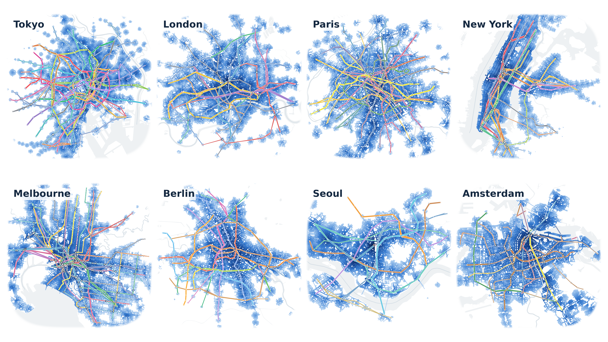
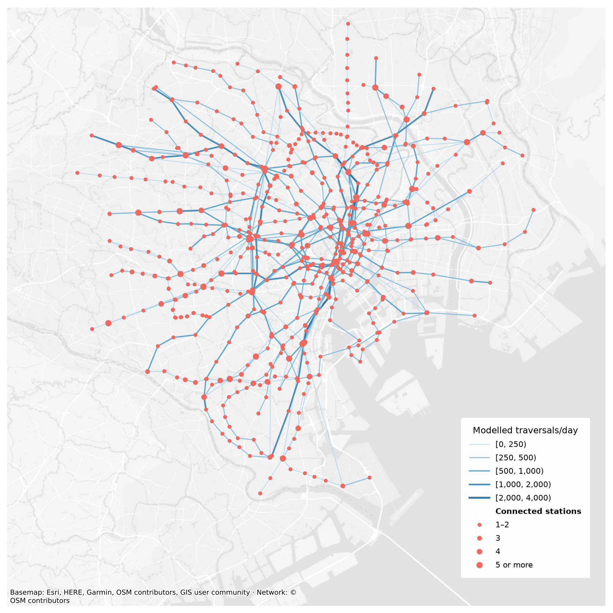
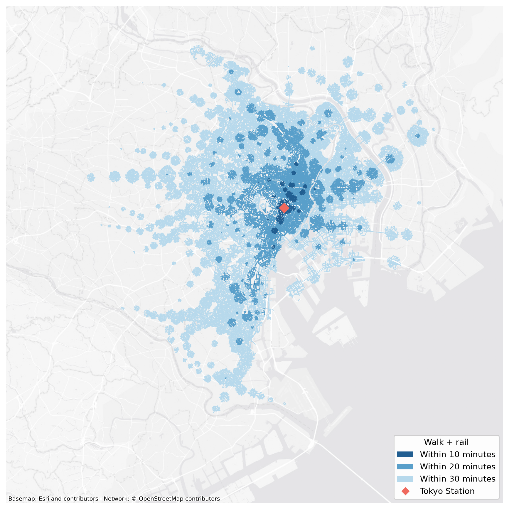
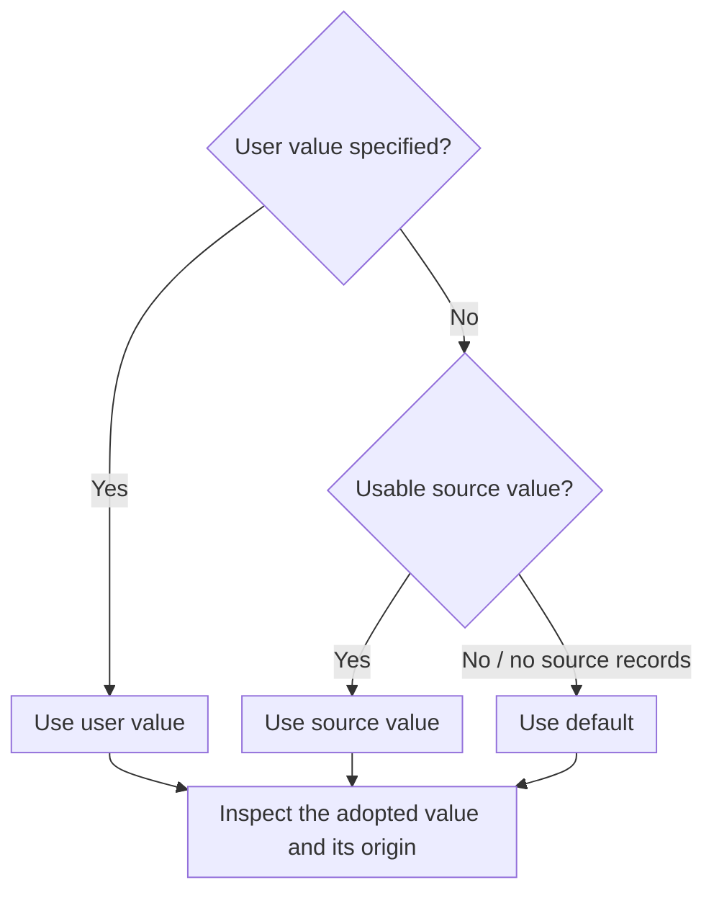

# How to approximate GTFS from OpenStreetMap with City2Graph

City2Graph generates synthetic GTFS feeds from OpenStreetMap (OSM) public
transport routes and converts them into public transport graphs in Python.
This example models subway, train and light-rail services in Tokyo's 23 wards,
then combines the rail graph with an OSMnx walking network to calculate
multi-modal accessibility as 10-, 20- and 30-minute isochrones. Start from a place
name, inspect the generated service assumptions, and customise operating
conditions for your accessibility analysis.

[](../assets/examples/synthetic_gtfs_world_isochrones.png)

<small> © [OpenStreetMap contributors](https://www.openstreetmap.org/copyright) · ODbL 1.0. Water context: [OpenFreeMap](https://openfreemap.org/) / [OpenMapTiles](https://openmaptiles.org/).</small>

## 1. Generate a rail graph { #start-with-a-place }

Load the mapped rail services to generate a feed:

<!-- gtfs-quick:osm -->
```python
import city2graph as c2g

con = c2g.load_osm_transport(
    place_name="Tokyo 23 wards, Japan",
    modes=["subway", "train", "light_rail"],
)
```

Convert the feed into station nodes and connections between consecutive stops.

<!-- gtfs-quick:osm-graph -->
```python
nodes, edges = c2g.travel_summary_graph(con)
```



??? example "Plot this map"

    <!-- gtfs-quick:osm-plot -->
    ```python
    import contextily as ctx
    import matplotlib.pyplot as plt
    import pandas as pd
    from matplotlib.colors import LinearSegmentedColormap
    from matplotlib.lines import Line2D

    area = c2g.get_boundaries("Tokyo 23 wards, Japan")
    nodes, edges = c2g.clip_graph((nodes, edges), area)
    days = c2g.get_gtfs_summary(con)["summary"].iloc[0]["service_days"]
    edges = edges.assign(frequency=edges["frequency"] / days)
    nodes, edges = nodes.to_crs(3857), edges.to_crs(3857)
    fig, ax = plt.subplots(figsize=(11, 11), facecolor="white")
    xmin, ymin, xmax, ymax = area.to_crs(3857).total_bounds
    half_width = max(xmax - xmin, ymax - ymin) * 0.52
    mid_x, mid_y = (xmin + xmax) / 2, (ymin + ymax) / 2
    ax.set_xlim(mid_x - half_width, mid_x + half_width)
    ax.set_ylim(mid_y - half_width, mid_y + half_width)
    ax.set_aspect("equal")
    ctx.add_basemap(
        ax, source=ctx.providers.Esri.WorldGrayCanvas,
        zoom=12, alpha=0.6, zorder=2,
        attribution="Basemap: Esri, HERE, Garmin, OSM contributors, GIS user community · Network: © OSM contributors", attribution_size=7,
    )
    frequency = edges["frequency"]
    breaks = [0, 250, 500, 1000, 2000, 4000]
    while frequency.max() >= breaks[-1]:
        breaks.append(breaks[-1] * 2)
    cmap = LinearSegmentedColormap.from_list("rail_blue", ["#abd5ed", "#559fc9", "#266a9b"])
    classes = pd.cut(frequency, breaks, right=False, labels=False)
    weights = classes / (len(breaks) - 2)
    widths = 0.65 + 1.35 * weights
    edges.plot(ax=ax, color=cmap(weights), linewidth=widths.to_numpy(), alpha=0.9, zorder=3)
    neighbours = {stop: set() for stop in nodes.index}
    for start, end in edges.index:
        neighbours[start].add(end)
        neighbours[end].add(start)
    sizes = [15.98 + 8 * min(max(len(neighbours[stop]) - 2, 0), 3) for stop in nodes.index]
    nodes.plot(ax=ax, color="#ef695e", markersize=sizes, edgecolor="none", linewidth=0, zorder=4)

    handles = []
    for index, (lower, upper) in enumerate(zip(breaks[:-1], breaks[1:], strict=True)):
        weight = index / (len(breaks) - 2)
        handles.append(Line2D([], [], color=cmap(weight), linewidth=0.65 + 1.35 * weight,
                              alpha=0.9, label=f"[{lower:,}, {upper:,})"))
    handles.append(Line2D([], [], linestyle="none", label="Connected stations"))
    for index, label in enumerate(["1–2", "3", "4", "5 or more"]):
        handles.append(Line2D([], [], linestyle="none", marker="o", color="#ef695e",
                              markeredgecolor="none", markersize=(15.98 + 8 * index) ** 0.5,
                              label=label))
    legend = ax.legend(
        handles=handles, title="Modelled traversals/day", loc="lower right",
        bbox_to_anchor=(0.98, 0.04), fontsize=8, title_fontsize=9,
        framealpha=0.96, facecolor="white", edgecolor="none",
        borderpad=1.1, labelspacing=0.7, handlelength=2.5,
    )
    legend.get_texts()[len(breaks) - 1].set_fontweight("bold")
    legend.set_zorder(6)
    ax.set_axis_off()
    plt.show()
    ```

### Calculate multi-modal accessibility as isochrones { #walk-and-rail-isochrones-from-tokyo-station }

Combine the generated rail service with walking streets to calculate 10-, 20-
and 30-minute reach from Tokyo Station.

<span id="download-the-walking-network"></span>

Geocode Tokyo's 23 wards with `get_boundaries`, then pass that boundary to
[OSMnx](https://osmnx.readthedocs.io/en/stable/user-reference.html#osmnx.graph.graph_from_polygon)
to download the walking streets.
Project both networks to Tokyo's local metric CRS so distances are in metres.
Walking speed is 4.5 km/h.

<!-- gtfs-iso:streets -->
```python
import geopandas as gpd
import osmnx as ox
from shapely.geometry import Point

place = "Tokyo 23 wards, Japan"
crs = 6677
walking_speed = 4.5 / 3.6  # metres per second

area = c2g.get_boundaries(place)
street_graph = ox.graph_from_polygon(
    area.geometry.union_all(), network_type="walk", retain_all=True,
)
street_graph = ox.project_graph(street_graph, to_crs=crs)
walk_nodes, walk_edges = c2g.nx_to_gdf(street_graph)
walk_edges["travel_time_sec"] = walk_edges["length"] / walking_speed
del street_graph
area = area.to_crs(crs)

latitude, longitude = ox.geocode("Tokyo Station, Japan")
origin = gpd.GeoSeries([Point(longitude, latitude)], crs=4326).to_crs(crs)
```

<span id="connect-streets-and-stations"></span>

Keep the complete directed rail graph, including routes continuing outside the
wards. `bridge_nodes` connects stations and street nodes within 250 m in both
directions.

<!-- gtfs-iso:connect -->
```python
rail_nodes, rail_edges = c2g.travel_summary_graph(con, directed=True)
rail_nodes = rail_nodes.to_crs(crs)
rail_edges = rail_edges.to_crs(crs)
node_layers = {
    "street": walk_nodes[["geometry"]],
    "station": rail_nodes[["geometry"]],
}
_, access_edges = c2g.bridge_nodes(
    node_layers,
    proximity_method="fixed_radius",
    radius=250,
)
```

Convert the bridge distances to walking time and add three minutes for entry
and waiting when boarding. Access links are used only for routing, so their
geometries can be omitted from the combined graph.

<!-- gtfs-iso:network -->
```python
rail_type = ("station", "ride", "station")
edge_layers = {
    ("street", "walk", "street"): walk_edges[["geometry", "travel_time_sec"]],
    rail_type: rail_edges[["geometry", "travel_time_sec"]],
}
for edge_type, connections in access_edges.items():
    boarding_time = 180 if edge_type[2] == "station" else 0
    edge_layers[edge_type] = connections.assign(
        geometry=None,
        travel_time_sec=connections["weight"] / walking_speed + boarding_time,
    )

multimodal = c2g.gdf_to_nx(
    nodes=node_layers,
    edges=edge_layers,
    directed=True,
    multigraph=True,
)
```

<span id="calculate-and-plot-the-reachable-streets"></span>

Start at the street node nearest Tokyo Station. `cut_edge_types` removes rail
and access links after calculating reachability, so the polygons follow reachable
streets. The 20 m buffer controls their display width.

<!-- gtfs-iso:calculate -->
```python
origin_node = walk_nodes.distance(origin.iloc[0]).idxmin()
center = walk_nodes.geometry.loc[origin_node]
isochrones = c2g.create_isochrone(
    graph=multimodal,
    center_point=center,
    threshold=[600, 1200, 1800],
    edge_attr="travel_time_sec",
    cut_edge_types=[rail_type, *access_edges],
    method="buffer",
    buffer_distance=20,
    resolution=4,
)
isochrones = gpd.clip(isochrones, area).sort_values("threshold")
```

This scenario uses average rail travel times and straight station-access links.
Transfers between rail services have no additional penalty. Walking is restricted
to the geocoded wards; rail journeys retain their full stopping sequences. The
polygons include street segments with both endpoints reached.



??? example "Plot the isochrones"

    <!-- gtfs-iso:plot -->
    ```python
    import contextily as ctx
    import matplotlib.pyplot as plt
    from matplotlib.lines import Line2D
    from matplotlib.patches import Patch

    colours = {600: "#215e91", 1200: "#599fca", 1800: "#b7d9ec"}
    view = isochrones.to_crs(3857)
    origin_map = origin.to_crs(3857).iloc[0]
    fig, ax = plt.subplots(figsize=(11, 11), facecolor="white")

    for seconds in reversed(colours):
        view.loc[view["threshold"] == seconds].plot(
            ax=ax, color=colours[seconds], linewidth=0, zorder=3,
        )
    xmin, ymin, xmax, ymax = area.to_crs(3857).total_bounds
    half_width = max(xmax - xmin, ymax - ymin) * 0.52
    mid_x, mid_y = (xmin + xmax) / 2, (ymin + ymax) / 2
    ax.set_xlim(mid_x - half_width, mid_x + half_width)
    ax.set_ylim(mid_y - half_width, mid_y + half_width)
    ax.set_aspect("equal")
    ctx.add_basemap(
        ax,
        source=ctx.providers.Esri.WorldGrayCanvas,
        zoom=12,
        alpha=0.55,
        attribution="Basemap: Esri and contributors · Network: © OpenStreetMap contributors",
        attribution_size=7,
    )
    ax.scatter(origin_map.x, origin_map.y, s=70, marker="D", color="#ef695e", zorder=5)
    handles = [
        Patch(facecolor=colour, label=f"Within {seconds // 60} minutes")
        for seconds, colour in colours.items()
    ]
    handles.append(Line2D(
        [], [], marker="D", linestyle="none", color="#ef695e",
        markersize=6, label="Tokyo Station",
    ))
    ax.legend(handles=handles, title="Walk + rail", loc="lower right", framealpha=0.95)
    ax.set_axis_off()
    plt.show()
    ```

### Inspect the generated feed { #inspect-the-generated-feed }

```python
report = c2g.get_gtfs_summary(con)
fields = ["pattern_count", "stop_count", "service_days", "mean_daily_departures"]
print(report["summary"][fields].T.to_string(header=False))
```

```text
pattern_count            310.000000
stop_count              1765.000000
service_days               7.000000
mean_daily_departures  32124.427494
```

The loader uses mapped station groups and reads operating intervals, including
weekday and peak-hour conditions. In this recorded run it generated 310
patterns; the ward view contains 662 nodes and 744 connections. Unusable
relations are reported and skipped by default (23 in this snapshot).
Inspect the adopted values and exclusions with `c2g.get_gtfs_summary(con)`.
Use `stop_level="platform"` to retain individual boarding IDs, or
`on_invalid="raise"` to require every selected relation to be usable.

The edge legend uses intervals `[lower, upper)`: the lower bound is included
and the upper bound is excluded. Node sizes count distinct neighbours,
with the largest size grouping five or more connections.

The loader fills missing operating conditions and records the values it uses.
The automatic reference week starts on the generation date in the local system
timezone. This map describes modelled
services rather than observed train frequency or crowding. OSM uses named,
unambiguous `stop_area` membership to group boarding locations. The graph
includes no transfer-time or platform-accessibility model.

Overture Maps is currently unsupported for GTFS generation. Its
[transportation data](https://docs.overturemaps.org/guides/transportation/)
describe physical infrastructure, but do not provide complete public transport
routes with the ordered station calls and operating patterns required by this
workflow. Inferring service from track connectivity or station proximity can introduce
incorrect station connections and arbitrary service counts. Use OSM's mapped
transport relations or supply explicit transport tables with `create_gtfs`.

The next section changes the operating conditions while keeping the same mapped
network. The [generation reference](../api/gtfs_generation.md#generation-flow)
explains how user settings, OSM tags and defaults produce each value.

## 2. Set the operating conditions { #generate-a-feed }

<span id="2-decide-what-to-enter-and-what-to-leave-automatic"></span>

Once the routes, stops and stopping order are known, specify only the operating
conditions you want to control. Apply this flow separately to each condition.
In this example the source is OSM. With custom input tables, source records
are optional; absent source values lead to defaults.

<div class="gtfs-flowchart" markdown="1">



</div>

The defaults are modelling assumptions. Check the adopted values before using
travel times or service counts in an analysis.

The quick start uses source operating tags, station groups and estimated travel
times. Add only the conditions you want to change. For example,
model departures between 07:00 and 09:00 at ten-minute intervals:

<span id="5-override-only-the-necessary-fields"></span>

<!-- gtfs-example:settings -->
```python
settings = {
    "start_time": "07:00:00",  # First departures
    "end_time": "09:00:00",    # Departure window ends (exclusive)
    "headway_secs": 600,       # Ten minutes per pattern
}
```

These are the only custom operating values in this example. Speed, dwell,
distance estimation and the reference week keep their automatic values.
The explicit interval replaces the source's base and time-of-day intervals.
Remove a key to return that condition to source-first completion. A pattern is
one stopping sequence in one direction; `group_headway_secs` can instead share
a departure rate across a group.

After running the quick start, rerun its loader with `**settings`:

<!-- gtfs-example:osm -->
```python
configured_con = c2g.load_osm_transport(
    place_name="Tokyo 23 wards, Japan",
    modes=["subway", "train", "light_rail"],
    **settings,
)
configured_nodes, configured_edges = c2g.travel_summary_graph(configured_con)
```


For a map of this scenario, use `configured_nodes` and `configured_edges` in the
quick-start plotting block. The original `con` remains available for the
accessibility example in section 1.

The settings dictionary controls the whole generated service. Use the first
detail below for more operating settings, the second to change the downloaded
network, and the third for conditions that vary by pattern or stop.

<span id="parameters-you-can-set"></span>

??? reference "Set operating conditions for the whole feed"

    <span id="operating-conditions"></span>

    These arguments work with `create_gtfs` and `load_osm_transport`. Put the conditions you want to change in
    `settings` in the configured examples above.

    <!-- gtfs-defaults:controls -->

??? reference "Select routes, modes and boarding locations"

    <span id="source-and-selection"></span>

    Pass these directly to the appropriate loader.

    | Parameter | What it selects or controls | If omitted |
    |---|---|---|
    | `area` / `place_name` | Download boundary, or a place to geocode | Supply an area/place, or OSM `relation_ids` |
    | `relation_ids` (OSM) | Specific route relations | Find routes in the selected area |
    | `route_name` | OSM route-name filter | No name filter |
    | `route_ref` (OSM) | Route reference, such as a line code | No reference filter |
    | `modes` | Transport modes, e.g. `"subway"` or `["subway", "train"]` | All supported or supplied modes |
    | `pattern_ids` | Patterns to generate; also accepted by `create_gtfs` | All selected patterns |
    | `data` | Explicit transport tables for `create_gtfs`; supplemental tables for OSM | Required for `create_gtfs`; OSM derives its input from relations |
    | `use_source_tags` (OSM) | Whether to use supported operating tags | `True` |
    | `overwrite_source` | Whether supplements may replace source values | `False` |
    | `stop_level` (OSM) | Group mapped station areas, or retain individual boarding IDs | `"station"` |
    | `on_invalid` (OSM) | Skip unusable relations with recorded reasons, or require all with `"raise"` | `"skip"` |
    | `endpoint` / `timeout` (OSM) | Overpass server and request timeout | Configured [server and timeout](../api/gtfs_generation.md#osm-retrieval) |

??? reference "Set conditions for individual patterns and stops"

    <span id="per-pattern-and-per-stop-values"></span>

    These are table columns, not global keyword arguments. A row-specific
    operating value takes priority over the corresponding global setting.

    | Table | Fields you can set | Purpose |
    |---|---|---|
    | `services` | `pattern_id`, `headway_secs`, `start_time`, `end_time` | Conditions for named patterns; unlisted patterns remain |
    | `services` | `departure_time` | One fixed departure per row |
    | `services` | `exact_times` | `0` for expected frequency counts; `1` for departures at exact intervals |
    | `services` | `trip_id`, `service_id` | Named trips and their calendars |
    | `stop_sequences` | `travel_time_secs`, `speed_kph`, `distance_m` | Incoming leg time, speed or distance |
    | `stop_sequences` | `dwell_time_secs`, `arrival_offset_secs`, `departure_offset_secs` | Dwell or complete timing offsets |
    | `stop_sequences` | `shape_dist_traveled`, `pickup_type`, `drop_off_type`, `stop_headsign`, `timepoint` | Cumulative distance and stop-level GTFS attributes |
    | `patterns` | `direction_id`, `service_group_id` | Direction and interval-allocation group |

    Dates and IDs connect these rows to the input tables. See the
    [table example and constraints](../api/gtfs_generation.md#from-your-own-tables).


### Check the values used { #4-inspect-values-warnings-and-counts }

<!-- gtfs-example:inspect -->
```python
report = c2g.get_gtfs_summary(configured_con)
print(report["services"][[
    "pattern_id", "date", "start_time", "end_time", "headway_secs", "departures",
]])
print(report["assumptions"][["record_id", "field", "value", "kind", "reason"]])
```

`services` shows the adopted intervals and windows for each modelled day.
In `assumptions`, `kind` records where each value came from:

| `kind` | Meaning |
|---|---|
| `user` / `override` | Explicit input |
| `source` | Interpreted source data |
| `default` | A fallback assumption |
| `estimated` | A calculation, such as distance divided by speed |
| `generated` | A generated identifier |
| `ignored` | Rejected information, with a reason |

Mapped local, express and through-service patterns can overlap. Check their
service scopes before interpreting summed edge counts as operating capacity.
These are modelled services, without validation against operator timetables or
passenger counts.

The OSM loader records exclusions under its default `on_invalid="skip"` policy:

```python
excluded = report["assumptions"].query("field == 'relation' and kind == 'ignored'")
print(excluded[["record_id", "reason"]])
```

### Save the feed { #6-save-restore-and-describe-research-use }

Save the generated feed as a GTFS ZIP with one call:

<!-- gtfs-example:save -->
```python
c2g.save_gtfs(configured_con, "synthetic.zip")
```

## 3. Across eight cities { #across-eight-cities }

The Tokyo accessibility panel uses the same recorded feed, origin, projected
coordinate system and ward boundary as the worked example, with thresholds
extended to one-minute intervals.
The other cities use their selected synthetic feeds and local walking networks.

[](../assets/examples/synthetic_gtfs_world_isochrones.png)

© OpenStreetMap contributors.

The figures are static illustrations based on source data retrieved in November
2026. Running the examples retrieves current OSM data, so network coverage and
results can change. Raw downloads, generated GTFS archives and intermediate
graphs are kept outside Git. The code in this tutorial is the maintained workflow;
the repository retains the published PNGs and small synthetic test inputs.
