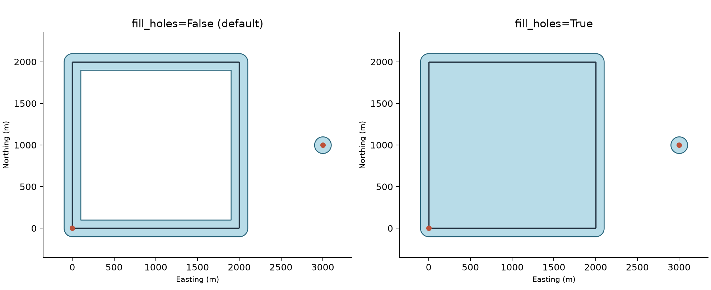

# Filling holes in buffer isochrones

`create_isochrone(method="buffer")` buffers reachable nodes and available edge
geometries, then combines the resulting polygons. Road circuits can enclose
holes in this footprint. From City2Graph 1.1.0, pass `fill_holes=True` to remove
every interior ring after the polygons have been combined.

Hole filling is optional. The defaults remain `fill_holes=False`,
`buffer_distance=100` and `method="concave_hull_knn"`. Select `method="buffer"`
explicitly to use this option. Existing buffer calls retain their results.

## Before and after

The example below uses a synthetic road circuit and a separate reached point.
Both panels use the same origin points, threshold and 100 m buffer. Filling
removes the enclosed hole but leaves the gap to the separate part untouched.
The added area is a cartographic choice: it does not imply that roads or other
locations within the filled hole are reachable.



Run this complete example to reproduce the figure. No external data download is
needed. The coordinates are synthetic and use a projected CRS with metre units.

```python
import geopandas as gpd
import matplotlib.pyplot as plt
import networkx as nx
from shapely.geometry import LineString, Point

import city2graph as c2g

graph = nx.cycle_graph(4)
graph.graph["crs"] = "EPSG:27700"
positions = [(0, 0), (2000, 0), (2000, 2000), (0, 2000)]
nx.set_node_attributes(graph, dict(enumerate(positions)), "pos")
for source, target in graph.edges:
    graph.edges[source, target].update(
        travel_time=5,
        geometry=LineString([positions[source], positions[target]]),
    )
graph.add_node(4, pos=(3000, 1000))
origins = [Point(0, 0), Point(3000, 1000)]

options = dict(
    graph=graph,
    center_point=origins,
    threshold=10,
    edge_attr="travel_time",  # Minutes in this synthetic network.
    method="buffer",
    buffer_distance=100,  # CRS units, metres here.
)
unfilled = c2g.create_isochrone(**options)
filled = c2g.create_isochrone(**options, fill_holes=True)

roads = gpd.GeoSeries(
    [data["geometry"] for _, _, data in graph.edges(data=True)],
    crs=graph.graph["crs"],
)
fig, axes = plt.subplots(1, 2, figsize=(11, 4.5), layout="constrained")
for ax, footprint, title in zip(
    axes,
    [unfilled, filled],
    ["fill_holes=False (default)", "fill_holes=True"],
    strict=True,
):
    footprint.plot(ax=ax, color="#b8dce8", edgecolor="#28647a", linewidth=1)
    roads.plot(ax=ax, color="#263746", linewidth=1.4)
    gpd.GeoSeries(origins).plot(ax=ax, color="#bd5139", markersize=25, zorder=3)
    ax.set(
        title=title, xlabel="Easting (m)", ylabel="Northing (m)",
        xlim=(-350, 3350), ylim=(-350, 2350),
    )
    ax.set_aspect("equal")
    ax.spines[["top", "right"]].set_visible(False)
fig.savefig("isochrone_holes.png", dpi=180, facecolor="white")
```

## Parameters and interpretation

| Parameter | Default | Behaviour |
| --- | --- | --- |
| `buffer_distance` | `100` | Buffers reachable geometries in CRS units. |
| `fill_holes` | `False` | When `True`, removes all interior rings from the combined buffer result. Must be a Python `bool`. |
| `allow_holes` | `False` | Applies only to `method="concave_hull_alpha"` and controls holes during hull construction. |

`fill_holes` applies only to the buffer method. It does not widen the buffer,
close gaps between separate parts, alter shortest-path calculations, or change
the hull methods. A polygon inside a filled hole becomes part of the surrounding
filled polygon. Parts outside those exteriors remain separate.

Distances retain the units of the input CRS. Use a suitable projected CRS for
buffering: `100` means metres only if that CRS uses metres. No automatic
reprojection or unit conversion is performed. The existing meaning of
`buffer_distance=None` is unchanged: it skips the usual buffer, while
degenerate point or line results still receive the existing fallback buffer.

A sequence such as `threshold=[15, 5, 15]` returns one row per requested
threshold, preserving order and duplicates. Hole filling is applied to each
layer independently. It does not add cumulative unions or impose nesting
between layers. Origin snapping and network reachability are unchanged.

## Clip after filling

Filling removes all holes, including ones corresponding to lakes or excluded
land. To retain those exclusions, clip **after** filling. The clipping boundary
must contain the exclusions as interior rings and use the same CRS as the
isochrones. For example, continuing from the synthetic example above:

```python
from shapely.geometry import Polygon

study_area = gpd.GeoDataFrame(
    geometry=[
        Polygon(
            [(-200, -200), (3200, -200), (3200, 2200), (-200, 2200)],
            holes=[[(700, 700), (1300, 700), (1300, 1300), (700, 1300)]],
        )
    ],
    crs=filled.crs,
)
clipped = gpd.clip(filled, study_area)
```

The clipped result can contain holes again, deliberately preserving the
excluded area. To retain the original buffer footprint instead, omit
`fill_holes` or pass `fill_holes=False`.

See the [Utils API reference](../api/utils.md) for the full function contract.
